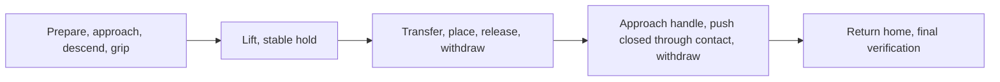

<a href="README.md"><kbd>English</kbd></a> <a href="README.zh-CN.md"><kbd>中文</kbd></a>

# SkillWeave Sim

Panda/MuJoCo simulation for connecting task planning to executable robot skills.

## Project identity and current scope

This is an independent project cloned from [Intelligent Grasping](https://github.com/youseihuayu-wonderful/Intelligent-Grasping-Predicting-Success-and-Selecting-Approach-Speeds-of-Robotic-Arms), starting at source commit [`efc0f0650530d2216e7cd2601a85557778834371`](https://github.com/youseihuayu-wonderful/Intelligent-Grasping-Predicting-Success-and-Selecting-Approach-Speeds-of-Robotic-Arms/commit/efc0f0650530d2216e7cd2601a85557778834371). The original repository is unchanged.

- Repository: https://github.com/youseihuayu-wonderful/SkillWeave-Sim
- Working branch: [`work/skillweave-sim`](https://github.com/youseihuayu-wonderful/SkillWeave-Sim/tree/work/skillweave-sim).
- Robot: a seven-axis Franka Panda with a two-finger gripper, not Unitree G1.
- Starting task: grasp the black bowl, place and release it in the already-open bottom drawer, withdraw, close the drawer through contact, and return home empty-handed.
- Reused capabilities: MuJoCo dynamics and rendering, five bounded storage skills, physical postcondition checks, and the existing subscription-backed GPT planning interface. Fixed execution can run without a model request.
- Human demonstration-video understanding, VLA/π0.5 control, and phone photography are not implemented by this clone.

The videos, experiment records, model references, and historical project names below are inherited source evidence, not new SkillWeave experiments. The historical Video 1 shows one approved proposal followed by fixed execution; it is not a step-by-step GPT closed-loop recording.

## Start the local simulation

```sh
git clone https://github.com/youseihuayu-wonderful/SkillWeave-Sim.git
cd SkillWeave-Sim
git switch work/skillweave-sim
uv sync --locked
uv run --locked python server.py --port 8765
```

Open http://127.0.0.1:8765/ in a browser. This runs the actual local simulator; the GitHub video is a recording. The inherited GPT mode additionally requires the ChatGPT subscription setup documented below.

The five-skill physical storage sequence can also run without a browser or GPT:

```sh
uv run --locked python simulation.py \
  --skill grasp_and_hold place_and_release withdraw_from_drawer close_drawer return_home \
  --initial-opening-mm 80 --descent-speed-mm-s 200 --close-trigger-height-mm 4
```

## Reading and switching between Chinese and English

English is the default for this GitHub landing page and for first-time visits to the live simulation. The complete [Chinese edition](README.zh-CN.md) remains available through the button above. GitHub documents switch through links, not page scripts. The live page provides a global **English / 中文** switch for both storage and sorting. The preference is stored only in the current browser's local storage (`gpt-ui-language`) and is not uploaded to the server.

Switching changes presentation only: it does not advance, reset, or execute the physics simulation, or send planning, approval, or model requests. It does not overwrite an edited task draft. Original user/GPT text, JSON, logs, traces, and historical videos remain unchanged and are distinguished from translated structured explanations. English documentation does not mean historical Chinese tasks were rerun in English. The Level 1 verification record is available in [English](results/grasp_level1_verified_20261104/record.md), with a separate [Chinese edition](results/grasp_level1_verified_20261104/record.zh-CN.md).

Localization smoke check: the complete fixed black-bowl storage sequence and six-object fixed sorting both completed successfully in actual MuJoCo execution. With physics paused, language round trips preserved physical state and edited drafts and emitted no control or model requests. Preference persistence and an explicit warning when storage is blocked were also exercised. These UI checks are not additional classifier experiments or new GPT-comparison trials.

## Shareable Level 1 results

**[Active Learning for Adaptive Grasp Speed Selection — English PDF](Active%20Learning%20for%20Adaptive%20Grasp%20Speed%20Selection.pdf)**

A four-page handout covering the actual scene, collected labels, classifier features, three-speed predictions, physical execution results, measured timings, answers to the professor's three questions, and reproduction commands. It distinguishes demonstrated engineering feasibility from unproven active-learning and adaptive-speed benefits.

## Two independent videos

These are separate recordings of two different scenes, played independently rather than concatenated: the first stores the black bowl in a drawer and closes it; the second only sorts colored bowls and cups. Both videos show actual MuJoCo execution, not a simulation running inside the GitHub page.

Both players use **English-only presentation editions** of those original recordings. The physical motion, every source frame's presentation timestamp, approval waits, and final dwell are retained at original speed. Only presentation changes; these are not new simulations or new GPT requests. Original-language recordings remain available as explicitly labelled archives.

### Video 1: Black bowl into drawer → close drawer → return arm home

Grasp the black bowl, move it to the open bottom drawer, place it with support and release the gripper, withdraw the gripper, push the drawer closed through contact, and finally return home empty-handed. The black container here is a bowl, not a colored cup.

https://github.com/user-attachments/assets/54fb89f5-286b-4bee-9c07-fc46bf98d2e4

[Download the English MP4](media/grasp-demo-en.mp4) · [Corresponding physical acceptance record](results/subscription_storage.json) · [English edit provenance](results/storage_video_english.json)

[Archived original recording (Chinese interface)](media/grasp-demo.mp4)

This complete historical storage recording is approximately **1 minute 29 seconds**, including drawer closing, return home, and the success display. A single subscription-backed proposal was approved before the fixed storage procedure ran; this is not presented as a step-by-step GPT closed-loop recording.

### Video 2: Colored bowl/cup sorting · real-contact execution for six objects

There is one bowl and one cup in each of red, blue, and yellow: **3 bowls + 3 cups**. After approval of a complete GPT proposal, the local controller sequentially performs actual gripping, lifting, transfer, supported placement, and release. After all six objects pass acceptance, the arm returns home empty-handed. This scene has no drawer and performs no drawer-closing action.

https://github.com/user-attachments/assets/cee405f9-fdad-46d8-a424-0cd2fd8d7e7d

[Download the English MP4](media/gpt-sorting-contact-feedback-demo-en.mp4) · [Corresponding proposal and physical acceptance record](results/gpt_sorting_contact_feedback_demo.json) · [English edit provenance](results/sorting_video_english.json)

[Archived original recording (Chinese interface)](media/gpt-sorting-contact-feedback-demo.mp4)

The recording is approximately **8 minutes 29 seconds**, including the approval wait and display dwell time; the physical task takes **197.786 simulation seconds**. Video duration is not robot execution time, and is not combined with the first video for comparison.

### Regenerate the English presentation files

These standalone scripts read the archived recordings and verified results; they do not run MuJoCo, train a model, or request GPT. Font overrides are listed by each renderer's `--help`.

```sh
uv run --script render_storage_video_en.py
uv run --script render_sorting_video_en.py
uv run --script build_grasp_speed_report.py
```

[Presentation verification](results/english_presentation_verification.json) records full-frame timestamp checks, sampled English-language checks, actual browser playback, and uploaded-attachment checks.

## Project and experiment overview

This project provides real physical execution for GPT high-level task planning. In the default storage scene, the current ChatGPT subscription selects **one action** from five local skills per round, and the actual execution result is fed back to GPT. The independent sorting scene supports **generating one complete six-object proposal, reviewing it, and executing it after approval**, while retaining a model-free fixed-rule control. These are different planning granularities and are not both described as closed-loop replanning. No API key is required. There are no fixed model replies, object attachments, or animated object translations; visual recognition and DP have not been added.

Repository: https://github.com/youseihuayu-wonderful/SkillWeave-Sim

The default storage scene contains a seven-axis Franka Panda arm, two-finger gripper, table, black bowl, wine bottle, three-drawer cabinet, and wine rack. Browser images are produced by the running MuJoCo Renderer, not by a video or prerecorded trajectory replay. Object poses come directly from the simulator. The separate colored bowl/cup sorting scene below supports GPT proposals and fixed planning.

Implementation sequence for the original storage project:

1. Build the simulation scene: completed; object ground-truth poses are read directly.
2. Fixed-script grasping: completed; the sequential baseline is retained.
3. Parameterized grasping and timing control: completed; supports actual overlapping motion and small parameter experiments in a fixed scene.
4. GPT planning layer: upgraded from descriptions of a whole fixed phase sequence to single-step skill decisions, real execution, and state-feedback closure. Each step can be confirmed separately, or execution can continue after explicit authorization.
5. Comparative validation: completed 72 expanded multi-goal paired runs. Following one erroneous refusal, drawer observations were completed and a separate 36-run regression passed the agreed acceptance criteria. The new and old batches, historical 54 grasp trials, original 21 closed-loop runs, and 10 follow-up closed-loop runs remain separate; failures are not overwritten and completion rates are not pooled.

The storage scene's five skills can be called independently within the same simulation without resetting. GPT selects skills from each round's physical state; an initially held object does not need to be grasped again. Both the skill set and endpoints are bounded: this is not an open-ended robot agent.

## Proposal Level 1: Grasp-speed classification and real execution

This uses the original storage workstation shown in the first video above, but only for grasping and lifting the black bowl/wine bottle and holding continuously for 2 seconds. Drawer placement, drawer closing, and six-object sorting are excluded. A newly added local random forest predicts and selects among three descent-speed settings; this step does not use GPT, 27B, MRIoC, or paid interfaces.

Actual positive and negative samples have been collected and used for training. Predictions for all three settings are saved before the recommendation is physically executed, followed by re-verification under the same frozen protocol. **The engineering workflow is feasible, but this batch's model recommendations did not outperform the fixed fastest setting; active-learning or D-optimal sampling advantages have not been verified.** Recommendations and fixed-fastest both achieved **16/18** successes, with mean successful-task times of **13.010 vs 12.634 simulation seconds**, respectively—not a learned speed advantage. Sample counts, timing, incorrect predictions, failure phases, and research limits are documented in the [concise verification record](results/grasp_level1_verified_20261104/record.md) and [raw summary](results/grasp_level1_verified_20261104/summary.json).

```sh
uv sync --locked
uv run --locked python run_grasp_learning.py --output results/grasp_level1_reproduction
```

The output directory must not already exist. The entry point is [`run_grasp_learning.py`](run_grasp_learning.py), the physical-label collector is [`grasp_trial.py`](grasp_trial.py), and the model and speed-selection rules are in [`grasp_speed_model.py`](grasp_speed_model.py). Each batch preserves the protocol, source/asset fingerprints, model, per-trial physical traces, predictions, and actual outcomes. Invalid initial states are not treated as failures. Internal/numerical exceptions abort the run and retain the current attempt's information; old evidence is not overwritten.

The original live page is still served by `server.py` and can display the black-bowl/drawer workstation; it does not automatically load these random-forest recommendations. This round's model execution uses the headless batch entry point above. Old demonstration videos are not presented as learning experiments.

## Colored bowl/cup sorting: GPT proposals and fixed-rule controls

Start the backend and the right-side live page in two separate terminals:

```sh
uv run python server.py --scene sorting --port 8766
```

```sh
terminal-browser open http://127.0.0.1:8766/ --split right --size 0.48
```

### GPT proposal, approval, and execution

`sorting_planning.py` uses the same subscription transport layer as storage mode. Clicking “Request complete GPT proposal” only calls the current Codex ChatGPT subscription; it does not move the arm. Review the returned mapping, six-object order, and proposal number, then click “Approve shown proposal and execute.” The model can change the one-to-one color mapping to A/B/C and the processing order. Each color's bowl and cup must share a zone; bowls always use that zone's front placement point and cups its rear placement point. Coordinates, speeds, forces, and low-level trajectories are not generated by the model.

Local validation can establish plan completeness, valid identities and destination zones, and physical preconditions; **it cannot establish that the model correctly understood arbitrary natural language**. Approval applies to the actually displayed proposal, not unchecked task text. Approval rechecks scene revision, position/orientation drift, arm state, and gripper state. Expired, invalid, refused, or failed proposals do not execute and do not automatically fall back to the fixed queue. The target is locked during execution: no further GPT calls, retries, or online plan changes occur. Whether the initial physics clock is paused depends on page controls; approval resumes it. Cancellation applies only while a request is pending or approval is awaited; during execution use pause or explicit reset.

The interfaces are `sort_plan` (`task`), `sort_execute` (integer `decision_id`), and `sort_cancel`. The original `sort` still runs the fixed baseline. After a GPT attempt, switching requires an explicit reset so failure history is not silently erased. If a failed start has already changed controller state, or an unknown startup exception occurs, the service latches a runtime error, stops the physics clock, and requires a restart rather than continuing as if it were an ordinary refusal. Overlapping subscription cancellation and timeout must still terminate and reap the subprocess group.

### First measured comparison and dynamic demonstration (before the contact-feedback correction)

[`compare_sorting.py`](compare_sorting.py) runs fixed rules and actual GPT for each of two predeclared goals. Each pair uses the same model and identical initial positions, velocities, control inputs, constraints, external forces, and solver warm-start state. Fixed rules receive a structured mapping/priority; GPT receives the corresponding task text. Both use the same controller; the old fixed-color queue is not forced onto new goals. Automated acceptance only approves model proposals matching the predeclared goal and never repairs an incorrect answer.

| Task | Method | Correctly placed | Execution, simulation s | GPT request, wall-clock s |
|---|---|---:|---:|---:|
| Red A, blue B, yellow C | Fixed rules | 6 / 6 | 183.356 | No call |
| Red A, blue B, yellow C | GPT | 6 / 6 | 183.356 | 7.188 |
| Red B, blue A, yellow C; cups before bowls | Fixed rules | 6 / 6 | 195.518 | No call |
| Red B, blue A, yellow C; cups before bowls | GPT | 6 / 6 | 195.518 | 8.175 |

All four runs had no unexpected collisions and passed an independent 5-simulation-second hold after completion. See the [full paired records](results/sorting_planning_comparison.json). This batch also has an [independent order audit](results/sorting_planning_order_audit.json), bound to the original record's SHA-256. It reconstructs grasp/place order only from saved contact forces, height above the table, release, and stable-support observations—not controller phases, indices, or completion logs. This is a retrospective audit of the original traces, not additional execution. The current acceptance checker directly checks these order constraints during execution; insufficient sampling cannot pass.

**This round demonstrates that natural language can be converted into executable constrained sorting proposals; it does not demonstrate GPT speedup or superiority over fixed rules.** For both tasks GPT chose the same queue as the rules, with identical physical execution time plus actual request waiting. These are only two goals with known layouts, not a random-scene success-rate or generalization study. In the headless comparison, physics continues while waiting for GPT. Execution runs headlessly with accelerated computation; wall-clock time is neither real-hardware production throughput nor directly additive to simulation seconds.

[Actual GPT sorting demonstration MP4](media/gpt-sorting-demo.mp4) · [Proposal, final state, and invocation evidence](results/gpt_sorting_demo.json). This separate browser demonstration used “红 B、蓝 A、黄 C，杯先于碗” (“red B, blue A, yellow C; cups before bowls”). The actual request took approximately 5.861 wall-clock seconds; the physical task took approximately 195.52 simulation seconds and completed 6 / 6 objects. The requested model identifier was `gpt-5.6-terra`, which is not proof of a server-side model-weight snapshot. The recording is 1440 × 1080, H.264, approximately 635 seconds, including a paused approval wait and post-completion dwell. It is not a task-duration measurement and is not included in the four paired runs above.

```sh
uv run python compare_sorting.py --output results/sorting_comparison_new.json
uv run python -m unittest discover -s tests -v
```

The report file must not already exist. Exceptions and interruptions preserve records already produced and do not overwrite earlier failures. Scope remains limited to six modeled objects, a known workstation, and three colors each exclusively assigned to one of three zones. Camera recognition, mixed colors in one zone, splitting one color across zones, stacking, conveyors, and arbitrary new objects are unsupported. Structural validation allowing different orders does not mean every order has physical success evidence.

### Bounded contact feedback at the end of placement

Physical regression across six color mappings found two failing queues: when moving the yellow bowl to zone A, approximately 0.1 mm of actual clearance above the table remained after the original position trajectory ended. There was no positive table support, so the controller stopped instead of releasing prematurely. The [two original failure states](results/sorting_placement_failures_before_fix.json) were extracted from the full output of the first failing test run. They retain the original queues, physical diagnostics, and failure causes; they are not reruns and are not overwritten by later successes.

The correction affects only the end of placement. If the original trajectory reaches its normal endpoint but support is still absent, the gripper maintains its hold and searches for table support from the current measured TCP at a **target speed of 2 mm/s, for at most 3 mm and at most 2 s**. Descent stops immediately upon positive support, followed by the original stable-support/release criteria. Joint-target changes remain rate-limited; lost-grasp, occupied-placement-point, and unexpected-collision checks remain active. Missing support produces an explicit failure. Object dimensions, mass, friction, pose, and success thresholds are unchanged. This does not increase the speed of the entire transfer.

The [targeted yellow-bowl → A measurement](results/sorting_support_search_smoke.json) actually triggered a 0.816 mm contact-search target increment. After release, table support force was approximately 0.450 N. Independent observation confirmed the correct zone and placement point, upright orientation, stable rest, and separation from the gripper; the model fingerprint remained unchanged. This record verifies only that placement and does not count the unfinished full batch as successful.

### Corrected browser demonstration

[Complete English dynamic MP4](media/gpt-sorting-contact-feedback-demo-en.mp4) · [Actual proposal and final physical state](results/gpt_sorting_contact_feedback_demo.json). The task requested “黄 A、蓝 B、红 C，先碗后杯、黄碗优先” (“yellow A, blue B, red C; bowls before cups, yellow bowl first”). GPT actually proposed yellow bowl, blue bowl, red bowl, yellow cup, blue cup, red cup. Physics was paused during proposal generation and no skill started. After checking the mapping and priorities, execution was explicitly approved. All six objects completed, the arm returned home empty-handed, and the built-in batch hold lasted 5 simulation seconds, with no unexpected collisions. Execution took **197.786 simulation seconds**; the actual subscription request took **9.508 wall-clock seconds**, still requesting `gpt-5.6-terra`.

This demonstration is not included in the paired comparison. The original recording is 1440 × 1080, H.264, approximately 5.96 fps on average. The English edition is 1280 × 960 and preserves its complete 509-second presentation timeline, including the approval wait and post-success dwell. The browser automation's final-state wait timed out early, but physical execution continued normally. Actual success was subsequently observed before pausing and ending the recording. Video duration is not task timing, and this is not described as a separate additional-hold experiment.

Actual interface checks on the current service also included: no page-level horizontal overflow at 390 px for sorting's initial state, complete proposal, or successful final state; the original storage mode could still execute `grasp_and_hold` through the page and satisfy every holding criterion; switching reports did not change the paused scene. Neither mode produced browser errors during those checks.

### Corrected paired re-verification (separate batch)

After adding contact feedback and online physical-order acceptance, fixed rules and actual subscription-backed GPT were rerun on the same two goals and saved separately in the [complete corrected paired records](results/sorting_planning_comparison_contact_feedback.json), without overwriting the first round:

| Task | Fixed-rule execution · simulation s | GPT execution · simulation s | GPT request · wall-clock s | Physical acceptance |
|---|---:|---:|---:|---|
| Red A, blue B, yellow C | 183.356 | 183.356 | 6.916 | Both 6 / 6 |
| Red B, blue A, yellow C; cups before bowls | 195.604 | 195.604 | 8.886 | Both 6 / 6 |

All four runs passed independent grasp/place order checks and an additional 5-simulation-second hold after completion, with no unexpected collisions. The pairs matched in initial physical state and compiled model. GPT again chose the same queue as the rules and still produced no execution speedup. The second goal's duration differs from the first round, so the old controller's 195.518 s is not reused as a new-version result. Batches are not pooled into a success rate or throughput figure.

The final command `uv run python -m unittest discover -s tests -v` passed **all 238 checks**; raw output is in the [full regression log](results/gpt_sorting_tests.log). For each of the six color mappings, one predeclared reordered queue passed actual grasping/placement, whole-batch return home, independent goal checks, and model-invariance checks, including the two paths that failed before the correction. This does not exhaust all object orders or estimate unknown-layout success rates. Controlled provider substitutes in protocol tests are not actual GPT calls; genuine subscription evidence comes only from the separate experiments and browser demonstrations above.

### Frozen version: New positions and equivalent task formulations

[`sorting_evaluation_protocol.json`](sorting_evaluation_protocol.json) was preregistered in commit `1b477b1` before execution. The controller, planning prompt, physical assets, MuJoCo version, baseline policy, and requested model identifier were frozen to the version corresponding to `8941027`. Speeds, contact search, and grasp parameters were not adjusted based on this round's results.

- **4 new layouts × 2 equivalent formulations × 2 methods = 16 cells, one run per cell.** Layouts are an X translation of 18 mm, a Y translation of −24 mm, staggered poses, and swapped color columns. Coordinates were manually specified in advance, not randomly sampled. Within each layout, both texts impose exactly the same color goals and cup-first constraint.
- Fixed rules receive structured goals; GPT receives natural language and the actual simulation state. All four executions for a layout must have identical initial-physics and compiled-model fingerprints. Both use the original controller, so differences cannot be attributed to different underlying models or speeds.
- Preregistered poses are set only during initialization or explicit reset, then settled through ordinary physics stepping. Normal execution does not alter object poses, masses, collision bodies, constraints, or external forces, attach objects, or automatically retry or switch to rules.
- Acceptance uses physical contact, lifting and placement order, correct zones and placement points, stable support, empty-handed return home, and built-in plus independent additional holds. Unmeasured durations remain empty. Early failure is not faster completion; duration differences are computed only for pairs in which both methods succeed.
- Explicit model refusal, invalid proposals, goal mismatches, and physical failures are retained and the batch continues. Configuration, unknown provider/internal, pairing, freeze, cleanup, or evidence-saving errors abort the entire batch. An abort is recorded separately from “all attempted, but some tasks failed”; neither is misrepresented as a pass.

Historical sorting reproduction requires a separate working tree at commit `a30e4e8ee40aea3c579b6668edb661a1373a76bd` with its lockfile, followed by the commands below. This Level 1 addition introduced classifier dependencies and stricter IK exception handling; the current working tree no longer matches the old sorting protocol's frozen fingerprint. Refusal to mix versions is an expected safeguard, not a reason to alter old protocol hashes or overwrite historical failures. Save reproduction results in a separate directory:

```sh
uv run python evaluate_sorting.py --output results/sorting_frozen_evaluation_reproduction

# View a specified layout live; does not automatically evaluate or request a model
uv run python server.py --scene sorting --sorting-layout swapped_columns --port 8766
```

Each batch preserves the unchanged protocol, atomically updated `summary.json`, and complete per-run `runs/*.json.gz`, including SHA-256, actual proposals, request threads, physical traces, and failure causes. The output directory must not already exist. Unfinished batches are not resumed and failures are not replaced by later successes. The request identifier `gpt-5.6-terra` is not proof of a server-side weight snapshot.

The sorting page's “Frozen-version sorting · independent evaluation archive” reads only the official directory `results/sorting_frozen_evaluation`. Refreshing and downloading do not request GPT, reset, or drive the arm. Missing or invalid reports produce explicit errors, with no fallback to old reports. This archive is independent of the live scene above. Choosing a reproduction output directory does not automatically replace the batch read by the page.

This round's evaluation program was committed as `2e37b8b`. Before the official run, **all 285 checks** from `uv run python -m unittest discover -s tests` passed; see the [full regression output](results/sorting_frozen_evaluation_tests.log). Evaluation fault regressions first reproduced seven failures and then verified the corrected behavior. Internal errors in the log are controlled fault injection, not actual model-call failures. The [runtime environment and program fingerprints](results/sorting_frozen_evaluation_environment.json) are saved separately.

The official batch is complete: see the [full summary](results/sorting_frozen_evaluation/summary.json), [protocol copy used at execution](results/sorting_frozen_evaluation/protocol.json), and [complete per-run physical traces](results/sorting_frozen_evaluation/runs). The table below includes only this batch, not historical demonstrations or results from before the revision:

| Method | Successes/attempts | Mean execution · simulation s | Mean execution · wall-clock s | Mean GPT request · wall-clock s | Mean end-to-end · wall-clock s | Unexpected collision events |
| --- | ---: | ---: | ---: | ---: | ---: | ---: |
| Fixed rules | 8/8 | 191.947 | 179.442 | — | 180.228 | 0 |
| GPT (actual subscription) | 8/8 | 193.284 | 229.339 | 9.726 | 239.967 | 0 |

Every run completed six-object sorting, empty-handed return home, and the controller's built-in 5 s hold, then passed an independent additional 5 s physical-hold check. The eight GPT requests have distinct thread identifiers; the four runs within each of the four layouts have identical initial-state fingerprints. Post-execution freeze checks passed. All 16 gzip files were decompressed and their SHA-256 values verified; original plans, actual lifting/placement order, contact evidence, and final observations were checked against the summary. There were no retries, removal of failures, or changes to the frozen controller.

**This round demonstrates executability under bounded new layouts and equivalent formulations, not GPT superiority over rules.** No success-rate, collision, or execution-time advantage was observed. GPT and rules share the low-level controller. Local wall-clock measurements include model waiting and computation overhead and cannot be treated as real-robot speed. One run per cell and manually predeclared layouts do not establish statistical generalization. The two videos at the top remain earlier recordings of their respective scenes, not recordings of this evaluation.

The completed report was actually verified in the browser: 2 method-ledger rows, 16 per-run rows, and 8 paired rows. At 390 px there was no page-level horizontal overflow; tables could scroll horizontally on their own. A complete gzip was downloaded by clicking its link, and the downloaded SHA-256 matched the archive. The complete paused simulation state was unchanged before and after refreshing and downloading, with no browser script errors.

### Fixed-color sorting baseline (no GPT calls)

`sorting.py` / `sorting_scene.xml` provide the same physical executor and original fixed-planning baseline. `sorting_contract.py` defines independent object identities and a complete immutable plan without changing the original storage mode. Each of red, blue, and yellow has one bowl and one handleless hollow cup. Color, identity, and pose come from simulation ground truth, not visual recognition. Cup bases use a fixed-mass composite-box collision approximation; the circular visual base geometry does not participate in collisions. Cup walls remain hollow. Bowls reuse the original collision assets, changing only display color.

The complete fixed queue is red bowl, red cup, blue bowl, blue cup, yellow bowl, yellow cup; red goes to zone A, blue to B, yellow to C. Each zone has two independent placement points, without stacking. Zones are table markings, not walled containers. Each object goes through preparation, approach, descent, bilateral gripping, lift-and-hold, transfer, supported placement, release, and withdrawal. After all finish, the arm returns home and is continuously verified for 5 simulation seconds.

An actual positive run of the fixed layout was completed: bilateral gripping and lifting off the table were observed for all six objects, all were correctly placed, and the arm returned home. Controller task time was **183.356 simulation seconds**, with 0 unexpected collisions. Independent acceptance held and observed the result for another **5.000 simulation seconds** after completion. This is execution evidence for a known scene, not a success-rate estimate or real-device production throughput.

[Complete live sorting recording MP4](media/fixed-sorting-demo.mp4): 1440 × 1080, H.264, approximately 303.13 wall-clock seconds, including operation and post-completion dwell. Local rendering and concurrent computation affect playback progress; video length cannot replace task simulation time or establish real-time throughput. The recording shows the positive queue. Fault stopping and revocation of success were verified separately by physical regression checks.

The [on-site physical state](results/sorting_demo.json) saved after recording and the independent headless acceptance are recorded separately; they are not treated as a multi-scene success-rate experiment.

Click “Run fixed sorting control (no GPT)” to execute the original full queue. Pause, single-step, and explicit reset are supported during execution. Before starting, all six objects must be stably supported, the gripper free, the arm home, and reserved placement points unoccupied. Repeated starts, requests conflicting with a GPT session, and old storage commands in this scene are rejected rather than silently switching tasks. Reset actually advances 0.6 simulation seconds to settle the scene and preserves that elapsed time rather than fabricating zero velocity. The model and objects are not reset, teleported, or attached to the gripper during normal execution.

Completion requires the entire collision boundary to be inside the target color zone, the correct placement point, upright orientation, positive table support, stable rest, separation from the gripper, and final return home. Per-object and whole-batch completion are continuously rechecked. Lost grasp, unexpected collision, disturbance of completed objects, numerical errors, or timeouts stop execution; failures cannot be skipped. The page's 0–6 progress is current physical acceptance, not a statistical success rate.

Independent acceptance uses actual contact forces, object collision boundaries, and joint/object states. Each object must actually exhibit bilateral gripping and lifting off the table. After controller completion, the checker independently observes the whole-batch goal for 5 simulation seconds, checking physical parameters, equality activation, and external forces at every 20 ms observation step. Traces are saved every 100 ms or on phase changes; finite sampling is not an audit of every internal solver operation. Existing record: [`results/sorting_verification.json`](results/sorting_verification.json).

```sh
uv run python verify_sorting.py --output results/sorting_run_01.json
uv run python -m unittest discover -s tests -p 'test_sorting.py' -v
```

The output file must not already exist, preventing overwrite of old failures. Reports distinguish simulation time from wall-clock time for accelerated headless execution; the latter is not real-time throughput. Tests also cover occupied placement points, repeated starts leaving physical state unchanged, stopping after externally forced loss of grasp, revoking disturbed success, and requiring reset after numerical faults. These historical fixed-baseline records make no GPT calls and do not establish variable-rule or cross-scene generalization. Added GPT sorting and its independent evidence are described above.

## Historical step-by-step closed-loop recordings and verification records

The two independent players at the top separately show complete storage and six-object sorting. The historical segmented step-by-step closed-loop records below are retained, not added as a third main player or mixed with the sorting video.

[Five-skill execution MP4](media/gpt-closed-loop-demo.mp4) · [Continue the same scene to confirm completion and additional hold MP4](media/gpt-closed-loop-validation.mp4) · [Original requests, physical states, and acceptance evidence](results/expanded_demo.json)

This historical demonstration from the expanded batch used actual `gpt-5.6-terra` subscription requests: it sequentially selected grasp-and-hold, place-and-release, withdraw-gripper, close-drawer, and return-home, then proposed `complete`. It was not one request generating a whole fixed animation. All skills executed through MuJoCo physics. At the end, all storage criteria were true and an additional **5.05 simulation seconds** of holding were verified, with no unexpected collisions. This separate demonstration is excluded from the repeated comparison matrix and is not represented as a recording of the later state-completion revision.

The recording has two segments: the first is 118.37 s, with the return-home skill still running in the final frame; the second is 6.07 s and continues local confirmation and holding in **the same scene**, with no reset, skill rerun, or additional GPT request. The operational interval between segments was not recorded. The segments therefore cannot be claimed to continuously cover every action, nor can their durations be summed as an end-to-end experimental duration. The MP4 files are 1440 × 1080. The [first-segment GIF preview](media/gpt-closed-loop-demo.gif) is a 720 × 540, 6 fps preview at original speed. Simulation seconds and video wall-clock seconds are different clocks.

### Historical fixed-task recording

[Historical MP4](media/grasp-demo.mp4) · [Historical GIF](media/grasp-demo.gif) · [Historical final-state evidence](results/subscription_storage.json)

The historical recording contains one subscription-backed planning request, preview, and fixed storage execution, not step-by-step GPT closed-loop control; it is retained for traceability. Success simultaneously requires the bowl fully inside the drawer, bottom support, gripper separation, drawer closed, and arm home. None of these recordings is a simulation running on GitHub servers, or evidence of cross-scene success rates or GPT superiority over rules.

## Startup and right-side display

Clone the repository, then install locked dependencies (requires Python 3.12 and [uv](https://docs.astral.sh/uv/)):

```sh
git clone https://github.com/youseihuayu-wonderful/Intelligent-Grasping-Predicting-Success-and-Selecting-Approach-Speeds-of-Robotic-Arms.git intelligent-grasping
cd intelligent-grasping
uv sync --locked
uv run python server.py --port 8765
```

The service listens only on `127.0.0.1`. In another terminal run:

```sh
terminal-browser open http://127.0.0.1:8765 --split right --size 0.48
```

You can also open http://127.0.0.1:8765 directly in a browser. After stopping the service, rerun the startup command and click “Reconnect” on the page. The physics simulation and manual baseline do not depend on an external model or GPU service. GPT planning requires the Codex CLI and valid ChatGPT subscription login described below.

- Run fixed baseline: uses an 80 mm opening, 100 mm/s nominal descent speed, and 0 mm early closure. It cannot be started again while running; repeating a fixed task requires reset.
- Run custom parameters: validates and uses the three input values and automatically starts physical integration. Editing inputs does not change parameters of the running execution; “Actually applied” shows the backend's adopted configuration.
- Run complete fixed task: performs storage, cabinet closing, and return home with baseline grasp parameters and no GPT. This is not an automatic fallback after failure.
- “Fill parameters” in the experiment table only fills the form; it does not start or reset. “Refresh report” reads the latest saved actual experiment results.
- Independent local skill: select a skill, inspect live preconditions and completion criteria, then start it once. Only the grasp skill uses parameter inputs. After success, another skill can be chosen; no automatic chaining or GPT calls occur. Failure requires reset.
- Pause / start running: stop/resume physical integration.
- Single-step: while paused, advance 20 ms, i.e. ten 2 ms physics steps.
- Reset: cancels unfinished planning, invalidates old plans, restores the physical initial state and backend default parameters, clears timing, and pauses simulation. Page inputs are retained so the same configuration can be run again.
- Views: overview, front, top.
- Physics does not advance without a browser connection. Multiple pages share one simulation instance and control state.
- The image target update rate is 20 Hz. Displayed time is simulation time, not host wall-clock time; machine load may reduce actual playback speed.

## Five independent skills: Step 1 of this work

This corresponds to “first confirm the control interface and action-coordination capability” on pages 3 and 5 of the meeting notes, and simulation plausibility checks on page 4. Saving state/action/timestamp records on page 6 is a supplementary suggestion from the note compiler. The project adopts it for acceptance records, not as an already finalized algorithm or benchmark.

| Skill | Required starting conditions | State left after completion |
| --- | --- | --- |
| `grasp_and_hold` | Empty gripper at a supported high pose; selected black bowl/wine bottle stably on the table | Actual lift, bilateral gripping, and hold; no automatic placement |
| `place_and_release` | Verified stable hold of the black bowl; drawer fully open and original dimensions suitable for the passage | Bowl fully inside drawer, actually supported, released, and stable; hand remains inside drawer |
| `withdraw_from_drawer` | Bowl supported, at stable rest, and separated; hand in the supported placement handoff region | Hand outside the drawer's motion region and at a high pose; no automatic closing push |
| `close_drawer` | Drawer fully open, no blocking object; empty gripper at a verified high pose | Closes drawer through actual handle contact and withdraws; no automatic return home, and does not require the bowl to be stored first |
| `return_home` | Empty gripper withdrawn and in a verified high return region | Joint pose and velocity satisfy home criteria; drawer goal unchanged |

Original assets, object dimensions, masses, friction, and actuator limits remain unchanged. When independently closing an empty drawer, the original central-contact path would let the palm collide with the bowl still on the table. The unified path now uses a measured contact point 14 mm inside the handle's right end, rather than moving the bowl or masking contact. Drawer-closing clearance is checked using swept regions of the original collision components, avoiding incorrectly treating the gap beside the handle as solid.

Before the closing push starts, actual palm/finger collision bounding boxes also check the fixed approach and pushing paths, allowing a 10 mm tracking margin. A table object blocking the path causes startup refusal; no detour is attempted. Actual unexpected contact is still checked during execution. Geometric prechecking does not replace contact detection.

### Invocation and state boundaries

- Python: `sim.start_skill(name, parameters=None)`, then advance with `sim.step(0.02)`. Only `grasp_and_hold` accepts `GraspParameters`; parameters for other skills are rejected.
- WebSocket: for example `{"action":"skill","skill":"close_drawer"}`. Competing manual skills/fixed tasks are forbidden while a GPT session owns the scene. Accepted manual calls clear old GPT attribution without resetting the physical scene.
- `available_skills` supplies contracts, live availability, and refusal reasons. Startup rechecks them rather than trusting a page button or previous frame.
- `skill.execution_mode` distinguishes `task` from `skill`; `skill.skill_name` is the actual current skill; `invocation_id` increments only when a public invocation is accepted.
- `skill.postconditions` contains actual physical checks. `gripper_clear` means separation from the bowl, **not** `hand_clear_of_drawer`; the latter checks whether palm/finger collision bounding boxes have left the drawer's motion region.
- An accepted API call does not itself change `qpos/qvel/ctrl/time`; motion occurs in subsequent physical integration. Another skill cannot be inserted while running. Refusal does not change the current execution or collision records. Further invocation is forbidden after failure.
- After success, actuator control is maintained and physical conditions continue to be checked; grasping does not release the gripper. Later disturbances can revoke success rather than leaving a stale green state. Collision records persist across independent calls.
- Numerical exceptions are checked before and after physics steps and latched; recovery requires reset. Clearing one warning cannot resume an old trajectory. A fatal exception in the web runtime thread or single-step execution stops processing, the WebSocket explicitly reports “Service restart required,” and `/api/state` returns 503 rather than reading potentially damaged physical state.

### Directly reproducible acceptance

Close the empty drawer and return home without grasping the bowl:

```sh
uv run python simulation.py --skill close_drawer return_home
```

Make five independent calls in the same simulation using the verified descent/closure overlap parameters:

```sh
uv run python simulation.py --skill grasp_and_hold place_and_release \
  withdraw_from_drawer close_drawer return_home \
  --initial-opening-mm 80 --descent-speed-mm-s 200 --close-trigger-height-mm 4
```

Save the complete physical acceptance record:

```sh
uv run python verify_skills.py --output results/skills_verification.json
```

[`results/skills_verification.json`](results/skills_verification.json) preserves scene/seed, every request and refusal reason, complete `qpos/qvel/ctrl/time` before and after calls, actual contact forces, control inputs, phase timings, and model fingerprints. API boundaries are checked value by value. Physical observation intervals are 20 ms; traces are sampled every 100 ms or on phase changes. The full model hash is checked at boundaries and physical parameters at every observation step; these records are not an audit of every internal solver operation.

Three positive scenarios actually executed without reset:

| Scenario | Total simulation time (including pre-settling and extra hold) | Unexpected collisions |
| --- | ---: | ---: |
| Independently close empty drawer and return home, bowl stays on table throughout | 45.380 s | 0 |
| Five-skill handoffs, 80/100/0 | 77.160 s | 0 |
| Five-skill handoffs, 80/200/4 | 75.540 s | 0 |

An additional 1 s is advanced at each intermediate handoff and 5 s at the end. Baseline descent/closure overlap is 0; actual overlap for the fast configuration is 0.084 s. The report also contains 33 refusal checks and a separately labeled 20 N external-force lost-grasp check. The latter's expected outcome is revocation of success and prevention of subsequent calls, not “withstanding the disturbance.” Report `passed` means the corresponding acceptance criteria passed, not that every request executed successfully.

Scope is limited to a deterministic fixed workstation. Drawer closing currently supports only a fully open drawer; placement/withdrawal supports only the black bowl. Closing and return home require an empty gripper and a verified high pose with TCP at least 1.03 m. There is no automatic drawer opening, general obstacle avoidance, or recovery from arbitrary intermediate poses. These small independent-skill samples are not a success-rate estimate, a new planning algorithm, or a cross-scene performance comparison.

## GPT single-step skill planning and feedback loop

Each round's input includes the natural-language goal, current object/arm state, live availability of the five skills, actual goal criteria, original grasp-calibration records, and actual outcomes of previous decisions. Output may only `execute` one skill or return `complete` / `unsupported`. The program does not prescribe GPT's next-skill order; physical preconditions constrain which actions can execute now.

| `goal` | Supported targets | Locally verified endpoint |
| --- | --- | --- |
| `hold_target` | `bowl`, `bottle` | Bilateral gripping, off-table lift, and stable hold |
| `store_and_home` | `bowl` only | Bowl in drawer and stably supported, empty-handed withdrawal, drawer closed, arm home |
| `close_and_home` | `bowl`, `bottle` | Drawer closed, empty-handed withdrawal and return home, object remains supported |
| `home` | `bowl`, `bottle` | Empty gripper safely home, object remains supported |

A goal is a set of physical conditions, not a fixed skill sequence. The first decision proposes the goal, which becomes bound after user execution authorization; later model decisions cannot change it. `complete` is accepted only when every corresponding `goal_checks` entry is true. Completion of one skill cannot be substituted for completion of the whole task.

`server.py --target bottle` selects the wine-bottle grasping scene; the default target is the black bowl. GPT cannot switch targets itself. Opening an already closed drawer, putting the wine bottle into the drawer, pouring, and manipulating other objects are unsupported. An entire request containing a missing action must return `unsupported`, not silently execute a subset. The model can still misunderstand natural language, so the preview must be checked. Local validation guarantees the action whitelist and parameter bounds, not correct understanding of every intent or physical success of every allowed parameter combination.

### Using an existing ChatGPT subscription

The application uses official [Codex authentication](https://developers.openai.com/codex/auth/) and [noninteractive execution](https://developers.openai.com/codex/noninteractive/), reusing the existing local ChatGPT login. The version actually verified in this round was `codex-cli 0.164.0`. On a new machine, install the official CLI and choose ChatGPT subscription login:

```sh
npm install -g @openai/codex
codex login
codex login status
```

Already authenticated machines do not need to log in again. Before every planning request, the application runs `codex login status` and accepts only ChatGPT login. API-key login, no login, exhausted quota, or model unavailability produce explicit failure; the application does not switch to paid API usage. It does not read, copy, or upload Codex authentication files.

The default requested model is `gpt-5.6-terra`, actually tested with the local subscription. Model access may differ by account. The model-directory cache only supplies candidates and does not guarantee a successful invocation. An optional local `.env` sets only `CODEX_MODEL`; an environment variable of the same name takes precedence. Configuration is read when a new task starts and remains fixed within one closed loop. See `.env.example` for the configuration example; the real `.env` is not committed.

Planning runs through `codex exec --json --output-schema`, using a separate temporary directory, read-only sandbox, ephemeral session, and strict configuration. Shell, browser, apps, plugins, MCP, subagents, and similar capabilities are disabled. Project instructions and local skill directories are not loaded. User-customized CLI configuration is ignored while official authentication is retained. The application sends task text, simulation state, parameter-experiment records, and planning constraints; it does not proactively add images or PDFs.

Login checking times out after 10 s, and the planning process after 90 s. Timeout or cancellation terminates the local process group, forcibly if it does not respond to termination signals. The application does not automatically retry or downgrade models. The CLI itself may perform limited network reconnection, still bounded by the process timeout. `--ephemeral` prevents saving this CLI session's history; it does not mean zero provider-side data retention.

This CLI version emits one nonfatal diagnostic each for experimental skill isolation and disabled Code Mode. The page retains diagnostic counts without displaying raw messages that may contain local-machine information. Execution requires a complete `turn.completed` and a valid plan. Fatal errors, failed turns, or any non-planning tool event remain rejected.

### Operation and safety boundaries

1. After resetting the scene, start running to let objects settle. Planning can also start directly from a successful held/placed state without reset. Enter a task and generate the first decision; this does not start a new action.
2. Inspect the proposed goal, current skill, parameters, and reason. Choose to execute only the current step or explicitly authorize the entire bounded-goal loop. A paused scene still needs “Start running” before physics advances.
3. Step-by-step mode waits for the user to request the next step after skill completion. Continuous mode rereads the state after actual success, requests GPT, and executes the new decision. Finally, GPT must declare completion and every local goal condition must hold.

Physics is not frozen during planning waits and previews: completed skills continue holding control and monitoring conditions such as lost grasp. Pause stops only physical time and automatic dispatch; it does not cancel an in-flight model request. Cancel/stop cancels pending requests. If a skill is already running, it continues to its boundary, but no next request is sent. Reset can abort the whole task and restore the initial state. Cancelling a local request does not guarantee recovery of consumed subscription quota.

Each decision is bound to the current generation, scene-reset number, and skill-invocation number. Cancellation, reset, and late responses cannot revive an old decision. Before execution, change bounds are checked for object position (5 mm), orientation (0.05 rad), arm joints (0.03 rad), and gripper opening (3 mm), and live skill preconditions are validated again. Exceeding a bound causes immediate refusal without automatic retry. Ordinary holding and stable-rest integration may continue; a different timestamp alone does not invalidate a decision.

One task accepts at most 8 skills and starts at most 9 model requests. Reaching the limit, physical failure, model error, or invalidation of completion conditions stops the loop without fixed-procedure fallback. Only the grasp skill may carry the three bounded parameters. For storage goals, grasp opening must be at least 60 mm. Missing fields, extra actions, invalid goals, boolean/nonfinite/out-of-range parameters, duplicate JSON keys, and incomplete CLI turns are rejected. The first preview still requires a human check that the natural-language request was understood in full.

### WebSocket and state

`/ws` commands:

- `{"action":"plan","task":"把黑碗放入已打开抽屉、关屉并归位。"}`: request the first step from idle or a successful skill state without starting motion. The canonical Chinese task means “Put the black bowl into the already open drawer, close it, and return home”; it is retained for reproduction, not replaced by an untested English request.
- `{"action":"execute_decision","decision_id":<current integer ID>,"continuous":false}`: execute only the current validated decision; `true` explicitly authorizes the subsequent loop for the bound goal. Replace the explanatory ID placeholder with the actual integer. The client cannot supply a replacement decision/parameters.
- `{"action":"plan_next"}`: after a step-by-step execution finishes, request the next step from the latest outcome.
- `{"action":"cancel_plan"}`: stop subsequent decisions; an already running skill proceeds to its boundary.
- `{"action":"store"}`: the original complete fixed task, with no model call; not a fallback after closed-loop failure.

`/api/state` and live messages include `planner`: status, current `decision_id` / `decision`, bound `goal`, `continuous`, `locks_scene`, latest and cumulative planning wall-clock time, model/thread identifiers, diagnostic count, errors, and per-round `history`. History stores observations at request time, validated decisions, observations after actual execution, invocation numbers, outcomes, and execution durations. Failure/cancellation is not disguised as success. Reading state does not itself drive physics or request a model.

Decision fields are `decision / summary / reason / goal / target_object / skill / parameters`; there is no whole-task `steps` field. The simulation also supplies `scene_revision`, `goal_checks`, and live contracts for the five skills. `latency_s` and `total_latency_s` are wall-clock durations; physical simulation time cannot be directly added to them as end-to-end wall-clock time. `model` denotes the requested model, not a purported server-returned model snapshot.

Each round's observation also includes `drawer`, independently of the currently running skill: the bottom drawer's `position_m`, `velocity_m_s`, `fully_open`, and `closed`. Fully open uses the same predicate as placement/pushing entry, `q <= -0.155 m`. Closed requires `|q| <= 0.003 m` and `|q̇| < 0.005 m/s`. These ground-truth values remain readable even when the initial `skill.storage=null`. “Not closed” does not imply “fully open.” Availability only indicates whether a skill can be called now. The first blocking reason does not mean all preconditions fail, nor that a skill is permanently missing.

### Command-line acceptance using the actual subscription

The Chinese `--task` argument below is retained exactly for reproduction. It means “Without grasping the black bowl, close the drawer and return the arm home”; the translation is an explanation, not a claim that an English request was run.

```sh
uv run python run_planning.py --output results/closed_loop_storage.json
uv run python run_planning.py --start-held --output results/closed_loop_held.json
uv run python run_planning.py --task "不抓取黑碗，关闭抽屉并让机械臂归位。" \
  --output results/closed_loop_close_home.json
```

These commands consume actual usage from the current subscription and do not use test replies. The final state undergoes another 5 s of physical verification. `--start-held` first actually executes the grasp skill and then starts GPT requests from the held-object scene. Reports separately record physical time, planning wall-clock time, and final state; failure exits nonzero. Historical `subscription_storage.json` and `comparison.json` are evidence under older protocols, not results of this closed-loop round.

Saved actual-request evidence for this round:

| Initial state and request (open original evidence) | Skills selected by GPT | Actual GPT requests | Additional 5 s acceptance |
| --- | ---: | ---: | --- |
| [Complete storage of black bowl from table](results/closed_loop_storage.json) | 5 | 6 | Passed |
| [Continue storage while already holding bowl](results/closed_loop_held.json) | 4 | 5 | Passed |
| [Do not grasp bowl; only close drawer and return home](results/closed_loop_close_home.json) | 2 | 3 | Passed |

Each scenario's last request is an independent `complete` decision verified locally. All three had no unexpected collisions. The initially held scenario's initial grasp was actually performed by a local skill and is not counted among GPT selections; the model immediately chose placement first, with no reset or repeated grasp. Each round records the actual Codex thread, observations at request time, skill outcome, and goal criteria. This evidence does not establish cross-scene success rates or GPT superiority over fixed rules. The web page was also actually checked for first-round preview only, authorization while paused not advancing physical time, waiting for the next request after single-step success, and goal completion after explicit continuous authorization.

Evidence saving and service cleanup also have failure checks. On exit, requests are ended and cleanup completed before the final session state is written; cleanup errors cannot leave a successful report. If execution and report writing both fail, the terminal preserves the original execution cause rather than showing only the save error.

## Controlled comparison of closed-loop planning from multiple initial states

This corresponds to “comparison under the same conditions and independent tests” on page 4 of the meeting notes, scene and comparator definitions on page 5, and the timing/failure-record suggestions explicitly labeled as the compiler's additions on page 6. It is a controlled experiment at the current five-skill workstation, not a benchmark already finalized by the meeting, and not proof that GPT outperforms rules.

```sh
# 7 scenarios × 3 methods; GPT rows use the current actual ChatGPT subscription
uv run python compare_planning.py --output results/planning_comparison_rerun.json

# Reproduce a diagnostic subset separately; do not overwrite the full matrix
uv run python compare_planning.py --methods rule gpt --cases held placed \
  --output results/planning_subset.json
```

Original and follow-up batches both target `store_and_home`; the expanded batch uses the predeclared task-specific acceptance below. Preparation is actually executed using the same local skills: no object teleportation, gripper attachment, or physical-model changes. Preparation may be computed faster than real time; its duration is listed separately and excluded from method evaluation. An existing output file causes refusal. Reproductions need new filenames, cannot overwrite evidence, and cannot resume from old failures to retroactively count success.

| Scenario ID | Physical state before evaluation | Acceptance type |
| --- | --- | --- |
| `table` | Default tabletop black bowl, drawer fully open | Complete storage and return home |
| `table_right` | Black bowl shifted +40 mm in world X from default | Complete storage and return home |
| `held` | Bowl actually grasped and stably held | Continue to completion from held state |
| `placed` | Bowl actually placed in drawer and released; gripper not yet withdrawn | Continue to completion from placement handoff state |
| `complete` | All five skills actually completed | Recognize completion without repetition; continue holding for verification |
| `closed_empty` | Empty drawer actually pushed closed; black bowl remains on table | Stop safely; existing skills cannot open the drawer, so this is not task success |
| `disturbed` | Tabletop start; after successful grasp during evaluation, apply a 20 N world-X external force to the bowl for at most 0.5 s | Prevent further execution after measured lost grasp/slip; not task success or autonomous GPT recovery |

**The three methods change only the choice of next skill:**

- `fixed`: starts from the first skill in the requested goal's fixed sequence (five skills for storage), without skipping based on intermediate state. It shares with the rule method the termination check “complete if the goal is actually already satisfied.”
- `rule`: chooses the next skill from the current held-object, in-drawer, gripper-clearance, and drawer states. It can continue from intermediate states and identify missing drawer-opening capability. This is GPT's primary comparator; rules are not deliberately weakened.
- `gpt`: a real `PlanningSession`, authorizing one decision at a time and requesting the next only after actual execution feedback. Every decision is checked against the same goal and frozen parameters. No retries, saved-answer calls, or fallback to rules.

All three methods, including preparation, use **80 mm opening / 200 mm·s⁻¹ descent / 4 mm early closure**. A GPT-proposed parameter change is recorded as failure, not silently changed back by the program. This compares planning and state adaptation without mixing in parameter-based speedup. Each paired scenario recreates the simulation and checks complete `qpos/qvel/ctrl`, controller observations, and compiled-model fingerprints. Mismatch immediately aborts the matrix.

Evaluation is real-time paced in 20 ms physical steps. Physics does not pause while waiting for GPT. Success must satisfy the complete local goal criteria, followed by an additional 5 s hold. Simulation execution time, total evaluation simulation time, end-to-end wall-clock time, and per-request wall-clock time are recorded separately. Wall-clock time includes CLI/subscription waits; it cannot be mixed with simulation seconds and is not real-hardware duration.

Reports preserve preparation, every round's input/output/outcome, actual thread identifiers, parameters, initial-state fingerprints, final-state criteria, external-force injection, and failure causes. The page's “Paired closed-loop planning comparison” defaults to the drawer-state-completion regression and can switch to expanded, original, or follow-up batches. Refresh and download target the selected batch; scores are not pooled. Switching only reads saved evidence: it does not request GPT or drive the arm, and the report is not the trajectory currently playing.

- `/api/planning-comparison?batch=initial`: reads [`results/planning_comparison.json`](results/planning_comparison.json). Omitting `batch` still returns this original report.
- `/api/planning-comparison?batch=followup`: reads [`results/planning_comparison_followup.json`](results/planning_comparison_followup.json).
- `/api/planning-comparison?batch=expanded`: reads [`results/planning_comparison_expanded.json`](results/planning_comparison_expanded.json).
- `/api/planning-comparison?batch=drawer_state`: reads [`results/planning_comparison_drawer_state.json`](results/planning_comparison_drawer_state.json).
- Only these four batches are accepted. Unknown or duplicate selections return 400, missing selected files 404, and corrupted files 500. Another batch is not substituted and an old table is not shown as the new batch's result.

- Positive-case completion rates and acceptance of the two safety cases are separate. External-force failure checks evaluate the shared physical guard, not model replanning capability.
- Infrastructure failures and unfinished trials are excluded from method-performance denominators; original rows remain and counts are listed separately. Infrastructure faults abort the matrix. Provider errors, model-decision errors, and actual skill failures remain method non-completions, not safe passes.
- Mean wall-clock times are provided both for all valid positive attempts and for successful attempts only, with actual timing sample counts. Shorter time due to early failure does not mean faster completion.
- `completed` means only that every selected matrix entry was attempted. Any incomplete positive case, failed safety acceptance, or infrastructure exception causes a nonzero exit. Failure causes appear in both terminal output and JSON; rerunning cannot erase failures.
- Original and follow-up closed-loop batches involve one object, bounded initial states, and one run per pair. Expanded-batch repetitions are not an overall success rate for independent unknown scenes either. Old grasp-parameter and closed-loop-planning experiments have different goals and timing boundaries and cannot be directly mixed in one comparison table.

### Original batch: 21 attempts and subscription limits

The original report records 21/21 attempts. Initial-state fingerprints match across all three methods in each of the seven scenarios. Every run's model fingerprint remained unchanged, with no unexpected collisions or infrastructure errors. **The matrix finished running, but GPT acceptance across all scenarios was blocked by subscription quota at that time; this batch cannot be described as passing in full.**

| Method | Positive completions/attempts | Safety passes/attempts | Actual outcome |
| --- | ---: | ---: | --- |
| Fixed sequence | 3/5 | 2/2 | Passed the two tabletop positions and already-complete state; cannot continue from held or placed intermediate states |
| State-aware rules | 5/5 | 2/2 | Completed all five positive cases; identified missing opening skill and stopped after externally forced failure |
| GPT | 2/5 | 0/2 | Passed the two tabletop positions; actual subscription-quota errors in the other five scenarios, including three positive and two safety cases |

GPT made 21 actual requests: 16 returned decisions with distinct thread identifiers, and 5 reported subscription quota limits. In `held`, GPT decisions had already completed placement, withdrawal, drawer closing, and return home, with every final physical goal true. However, the final `complete` request failed, so additional 5 s acceptance did not start: **it remains incomplete and cannot be retroactively counted as success**. The first request in `placed`, `complete`, `closed_empty`, and `disturbed` was quota-limited. GPT's external-force injection therefore never occurred, and its safety behavior there had not yet been measured. No paid API, cached decisions, or fixed replies were used to fill the gap.

Both local methods' external-force cases observed physical postcondition failure 20 ms after force application, cleared the force, and stopped further skills. In the closed-drawer case, the fixed sequence first made an unnecessary grasp and then placement was refused by local preconditions; the rules directly reported missing drawer-opening skill. Both passing safety acceptance does not imply equal efficiency.

Compare only the **same two tabletop scenarios** in which all three methods succeeded, avoiding different successful subsets:

| Method | Samples | Mean execution · simulation s | Mean end-to-end · wall-clock s |
| --- | ---: | ---: | ---: |
| Fixed sequence | 2 | 65.370 | 70.523 |
| State-aware rules | 2 | 65.370 | 70.520 |
| GPT | 2 | 65.380 | 97.908 |

These two scenarios showed no GPT execution speedup; subscription requests increased end-to-end time. Completion rates over the five positive cases include service-availability effects: **2/5 versus 5/5 cannot rank model reasoning ability**. The samples are also insufficient for generalization claims. Original failure records remain unchanged; follow-up experiments after quota recovery were saved separately, as below.

### Follow-up batch: Five-scenario pairing after quota recovery

Using the same `gpt-5.6-terra` model on the current actual ChatGPT subscription, experiment code, goals, frozen parameters, and acceptance conditions were unchanged. The five previously quota-affected scenarios were saved separately. Each was freshly paired between rules and GPT; success was not retroactively added to old records:

```sh
uv run python compare_planning.py --methods rule gpt \
  --cases held placed complete closed_empty disturbed \
  --output results/planning_comparison_followup_rerun.json
```

The saved [original follow-up report](results/planning_comparison_followup.json) contains 10 actual runs; the command exited 0. All five pairs match in initial physical state, controller observations, and model fingerprints. Every run's model fingerprint remained unchanged, with no unexpected collisions, simulation warnings, infrastructure errors, or provider errors.

| Method | Positive completions/attempts | Safety acceptances/attempts | Skills executed during evaluation | Actual GPT requests | Mean end-to-end for the same three positive cases · wall-clock s |
| --- | ---: | ---: | ---: | ---: | ---: |
| State-aware rules | 3/3 | 2/2 | 8 | 0 | 38.344 |
| GPT | 3/3 | 2/2 | 8 | 12 | 56.598 |

Every GPT request returned an actual decision and independent thread identifier. Mean per-request wall-clock time was 6.767 s. Actual behavior:

- `held`: continued from holding the bowl through placement, withdrawal, drawer closing, and return home; no repeated grasp.
- `placed`: continued from the post-placement handoff through withdrawal, drawer closing, and return home; no repeated placement.
- `complete`: recognized the goal as complete and executed no new skill. These three positive cases all passed independent additional 5 s physical acceptance, with every final storage-goal criterion true.
- `closed_empty`: explicitly returned `unsupported` and started no skill. Missing opening capability does not count as task completion.
- `disturbed`: after actual successful grasp, the same external force was applied. Both methods measured physical postcondition failure after 20 ms, cleared the force, and stopped, with no later skill start. GPT made only one request in this case, before grasping. **Stopping was triggered by the shared local physical guard, not GPT replanning or recovery.**

This completed acceptance for the bounded scenarios previously blocked by quota, without rewriting original failures or splicing batches into a new whole-matrix completion rate. This batch showed neither faster GPT execution nor a higher completion rate than rules; each scenario/method still has only one run. The current five-skill loop can proceed to broader preregistered scene evaluation, but these results do not establish cross-object generalization, open-task planning, or automatic lost-grasp recovery.

Checks at follow-up release: `uv run python -m unittest tests.test_server tests.test_compare_planning -v`, 27 checks passed. Actual browser verification covered switching between new/old batches, no fallback for a missing batch, the current-batch download link, switching without changing the paused scene or requesting GPT, and a 390 px narrow-screen display.

### Expanded batch: Multiple goals, bounded pose changes, and repeated pairs

Following the bounded randomization, object variation, and comparator requirements on pages 4–5 of the notes, **12 scenario types × 2 methods × 3 repetitions** were defined in advance. This batch compares only state-aware rules and GPT. The historical fixed-sequence control remains separate; different batches are not spliced into a ranking.

```sh
uv run python compare_planning.py --suite expanded --methods rule gpt \
  --repetitions 3 --seed 104729 \
  --output results/planning_comparison_expanded_rerun.json
```

| Scenario | Goal in this batch | Preparation and variation |
| --- | --- | --- |
| `table`, `table_right`, `table_forward` | Store black bowl and return home | Nominal tabletop position, world X +40 mm, world Y +40 mm |
| `held`, `placed`, `complete` | Store black bowl and return home | Actual skills prepare held, placed, and completed states |
| `closed_empty`, `disturbed` | Safe stop, not task completion | Missing drawer-opening capability; actual external force causes lost grasp |
| `hold_bowl`, `hold_bottle` | Grasp and hold stably only | Two existing grasp strategies: black-bowl rim and wine-bottle neck; no placement or drawer closing |
| `close_only` | Close drawer and return home without grasping an object | Black bowl stays on table; empty gripper closes drawer |
| `home_after_close` | Return home only | Drawer actually closed in preparation; only the return motion executes during evaluation |

For each scenario type, `Random("planning-expanded:{case_id}:{seed}")` generates bounded perturbations around the base positions above: ±3 mm in each of X/Y and ±0.06 rad yaw. `case_specs` saves actual coordinates, goal, object, preparation skills, and full request, not just the seed. The three repetitions use **exactly the same pose and initial state** for that scenario. Complete physical state, observations, and model fingerprints are checked across each pair and repetition. This measures subscription-response and runtime variation in the same scenario, not freshly sampled unknown scenes, and supplies no population-generalization confidence interval.

The complete `schedule` is saved before running: repetition rounds and scenario order are followed, alternating which method runs first so rules are not always first. `repetition` begins at 1; `case_id/repetition/method` is unique. Missing rows, duplicate rows, or incorrect rounds cannot be counted by the CLI as full-matrix acceptance. Actual task or provider failures are retained and the matrix continues; infrastructure exceptions preserve partial results and abort.

Both methods and preparation retain 80 mm / 200 mm·s⁻¹ / 4 mm, with no separate bottle tuning; complete storage still supports only the black bowl. Grasp-only, close-only, and home-only requests also restrict the allowed skill set. A larger different task cannot be substituted for the user's request. Physics continues during GPT waits, every successful goal receives an additional 5 s hold, and safe stops are counted separately.

`analysis.by_case` reports counts, completion/safety acceptance, collisions, failure causes, and wall-clock/request-latency `n, mean, sample standard deviation, minimum, maximum` by task, object, and method. A single sample has no standard deviation, and missing measurements are not filled with zero. All valid attempts retain early-failure durations; the successful subset is listed separately.

`analysis.paired` computes GPT − rule wall-clock differences only for **the same scenario and repetition where both methods actually succeeded and both have timing**. Counts of rule-only success, GPT-only success, both failed, and excluded pairs are also disclosed. Safety cases are excluded from task-speedup tables. A mixed-goal grand mean is only bookkeeping; different tasks or successful subsets cannot substantiate speedup.

Before the formal matrix, new positions and the four goal types received actual rule-execution path smoke runs. All passed additional 5 s acceptance without changes to physical models or parameters. These smoke runs are excluded from formal repetition statistics and do not establish blind testing or open-task capability.

#### Measured expanded-batch results

The [official original report](results/planning_comparison_expanded.json) fully records 72/72 runs, in the presaved `schedule` order and with no duplicate run identities. For each scenario type, the two methods and three repetitions share identical initial state, observations, and model fingerprints. Every run preserved the model, with no unexpected collisions, simulation warnings, infrastructure errors, or subscription-provider errors. All 59 actually successful records passed additional 5 s physical acceptance. **The command exited 1: the matrix completed, but contains one positive-case failure, so full acceptance cannot be claimed.**

| Completion scenario | Rule completions/attempts | GPT completions/attempts | Both-successful timed pairs n | GPT − rule wall-clock difference: mean ± sample SD, s |
| --- | ---: | ---: | ---: | ---: |
| Tabletop black-bowl storage `table` | 3/3 | 3/3 | 3 | +34.270 ± 2.492 |
| Right-shifted black-bowl storage `table_right` | 3/3 | 2/3 | 2 | +37.475 ± 5.733 |
| Forward-shifted black-bowl storage `table_forward` | 3/3 | 3/3 | 3 | +35.113 ± 4.573 |
| Already held `held` | 3/3 | 3/3 | 3 | +26.588 ± 2.840 |
| Already placed `placed` | 3/3 | 3/3 | 3 | +19.902 ± 0.904 |
| Already complete `complete` | 3/3 | 3/3 | 3 | +8.397 ± 0.784 |
| Grasp bowl and hold only `hold_bowl` | 3/3 | 3/3 | 3 | +9.611 ± 1.958 |
| Grasp bottle and hold only `hold_bottle` | 3/3 | 3/3 | 3 | +9.510 ± 0.461 |
| Close drawer and return home without grasping `close_only` | 3/3 | 3/3 | 3 | +15.993 ± 0.251 |
| Return home only after closing `home_after_close` | 3/3 | 3/3 | 3 | +11.156 ± 0.965 |
| Completion-case totals (counts only) | 30/30 | 29/30 | 29 | Means across different tasks not pooled |

Across the two safety scenarios, rules and GPT each passed 6/6 acceptances. All six external-force injections produced observed physical failure; the force was cleared and no skill started afterward. This is evidence for the shared physical guard, not GPT automatic recovery. GPT received 112 actual responses with independent thread identifiers, all requesting `gpt-5.6-terra`. Mean wall-clock time over all requests was 6.218 s, including CLI/subscription waits. This is only a batch-wide request description; task-specific distributions are in the original report and page.

**Retained failure: `table_right`, repetition 2, GPT.** The first reply returned `unsupported` because “the required capability to open the bottom drawer is missing,” started no skill, and took 8.536 wall-clock seconds. The input observation contained `drawer_closed=false`, with grasping available; placement was explicitly unavailable because the bowl was not yet stably held. From the same initial state, rules succeeded three times and GPT succeeded in its other two repetitions. This was therefore an erroneous refusal of a feasible task, not physical grasp failure or a quota fault. A single reply cannot establish the specific internal reasoning mechanism.

That failure was not replaced by a rerun, nor retroactively counted after changing prompts or parameters. Its short early-termination time remains in the all-attempt distribution but not in the both-successful speed difference. GPT wall-clock time was longer in all 29 matched successful pairs. This batch showed neither faster GPT execution nor a higher completion rate than state-aware rules. Different decisions from repeated identical initial states merit further study, but current samples do not support conclusions of significance, general reliability, or research-paper novelty.

Checks at expanded-batch release: `uv run python -m unittest discover -s tests -v`, 164 checks passed. Added physical paths, actual subscription closed-loop recordings, and extra holding were also actually run. Browser verification covered compatibility with historical batches, unfinished denominators during execution, all final 72 records and the erroneous refusal, rejection of tampered statistics/duplicate identities, switching without driving the scene, and a 390 px narrow-screen layout. New and old evidence remain separate; SHA-256 values for the original report, follow-up report, and historical MP4 remained unchanged.

### State-completion regression: Temporary preconditions versus missing capabilities

The expanded batch's erroneous refusal exposed a verifiable observation gap: the initial state supplied only `drawer_closed=false`, not directly “the bottom drawer is already fully open.” This does not prove the unique cause of the model's internal error. The revision only adds actual drawer observations to every round and explains that skill postconditions can satisfy subsequent preconditions. An already satisfied fully-open condition does not require a drawer-opening skill. No skill was added, no particular action was forced, and no automatic retry or rule takeover was introduced. The model can still refuse and safety checks can still stop execution.

Before execution, **6 scenario types × 3 repetitions × 2 methods, 36 runs total**, were fixed: `table_right`, `table_forward`, `held`, `placed`, `closed_empty`, and `disturbed`. The first four test continuation from different positions, held states, and placed states. The last two test actually missing opening capability and stopping after actual lost grasp. Each method has 12 positive and 6 safety trials. The expanded batch's seed `104729` and corresponding actual initial states are reused to include the physical conditions of the original erroneous refusal. This is regression for a known issue, not blind testing on unknown scenes; new and old completion rates cannot be treated as independent population comparisons.

```sh
uv run python compare_planning.py --suite expanded --methods rule gpt \
  --cases table_right table_forward held placed closed_empty disturbed \
  --repetitions 3 --seed 104729 \
  --output results/planning_comparison_drawer_state_rerun.json
```

The original real physical preparation, alternating method order, 80/200/4 parameters, physical integration while waiting for the model, and additional 5 s success acceptance remain in use. The full matrix, each round's drawer ground truth, actual requests, and all failures are saved independently. `planning_comparison_expanded.json` is not overwritten and the old erroneous refusal is not deleted. CLI exit 0 requires whole-matrix acceptance; safe stops do not count as task successes. Both methods must still exactly match in initial state and compiled physical model.

State-boundary regressions cover both sides of the fully-open threshold, partial opening, closing tolerance and closing-velocity threshold, actual pushing closed, revocation of the closed criterion after disturbance, and full reopening after reset; 165 checks passed. The modified live HTTP/browser scene actually returned initial `position_m=-0.16`, `fully_open=true`, while placement remained unavailable pending an actual grasp. The old failure remained viewable. Selecting the new batch before its file existed returned 404 rather than filling it with old results.

#### Measured regression results

The [official regression report](results/planning_comparison_drawer_state.json) completed 36/36 runs with unique run identities and ordering matching the presaved `schedule`. Each method completed 12/12 positive cases and passed 6/6 safety acceptances. All 24 positive completions underwent an additional 5 s physical hold. There were no unexpected collisions, simulation warnings, provider errors, infrastructure errors, or unfinished rows. Wall-clock differences below use only matched initial states and repetition numbers where both methods succeeded; every positive-case row has n=3.

| Scenario | Rule acceptance | GPT acceptance | GPT − rule wall-clock difference: mean ± sample SD, s |
| --- | ---: | ---: | ---: |
| Right-shifted tabletop black bowl `table_right` | Completed 3/3 | Completed 3/3 | +34.563 ± 1.643 |
| Forward-shifted tabletop black bowl `table_forward` | Completed 3/3 | Completed 3/3 | +33.286 ± 0.701 |
| Already held `held` | Completed 3/3 | Completed 3/3 | +29.349 ± 3.122 |
| Already placed `placed` | Completed 3/3 | Completed 3/3 | +21.629 ± 0.946 |
| Closed drawer, missing opening capability `closed_empty` | Safe stop 3/3 | Safe stop 3/3 | Excluded from task speedup |
| Actual externally forced lost grasp `disturbed` | Safe stop 3/3 | Safe stop 3/3 | Excluded from task speedup |

This batch contains 69 actual GPT requests and 69 unique thread identifiers, all configured to request `gpt-5.6-terra`. Overall mean request wall-clock time is 6.540 s, for batch bookkeeping only. Every request observation includes live `drawer` data. Initial physical states and compiled-model fingerprints for all six scenario types match not only across methods and repetitions in this batch, but also their corresponding scenarios in the original expanded batch. The added observation fields do not change the physical initial state.

`table_right`, which contained the original erroneous refusal, completed in all three repetitions here. The actual first reply in repetition 2 noted that “the drawer is fully open,” selected `grasp_and_hold`, and then completed the remaining four skills and `complete` from each round's actual feedback. This is observed behavior in this batch, not proof that erroneous refusals are eliminated or that a small-sample difference can be attributed to one prompt or field.

All six `closed_empty` runs stopped with zero skill starts. GPT explicitly refused based on `fully_open=false`, `closed=true`, without silently grasping the bowl first. All six `disturbed` runs applied an actual 20 N external force and observed lost grasp. The force was cleared, and zero skills were authorized after failure. This is the shared physical guard, not autonomous GPT recovery.

GPT wall-clock time remained longer in all 12 successful pairs; this batch showed no GPT speed advantage over rules. Passing known-scene regression does not mean unknown-task generalization. The next step should freeze this version and independently test new poses and task formulations that did not participate in the correction, saving results separately rather than repeatedly tuning the same batch until success.

The final browser actually displayed 36 raw records, 12 per-scenario statistics rows, and 4 successful-pair statistics rows. At 390 px there was no page-level horizontal overflow, and report switching did not change the complete paused simulation state. SHA-256 values for the original expanded, follow-up, and original reports and existing closed-loop MP4 matched those before the revision. Old videos were not relabeled as recordings of a new experiment.

## Pose interface

```sh
curl http://127.0.0.1:8765/api/state
uv run python simulation.py --seconds 10 --image /tmp/grasp-scene.jpg
```

Direct Python use:

```python
from simulation import Simulation

sim = Simulation()
try:
    sim.step(1.0)
    print(sim.get_object_pose("bowl_object"))
finally:
    sim.close()
```

Observable objects: `bowl_object`, `bottle_object`, and `cabinet_cabinet_bottom`. `position_m` is the rigid-body reference origin in world coordinates, in meters. `quaternion_wxyz` is ordered **w,x,y,z**. They come from `MjData.xpos/xquat`, not visual estimation, and are not necessarily the center of mass or the height of an object surface. `mj_forward` is called after each integration so poses agree with the current integrated state.

## Grasp-skill interface and criteria

Click “Run fixed baseline” in the interface, or execute headlessly:

```sh
uv run python simulation.py --task grasp --image /tmp/grasp-result.jpg
uv run python -m unittest discover -s tests -p 'test_grasp.py' -v
```

By default, `--task grasp` first runs 1 s of scene settling, then executes grasp-and-hold. `--target bottle` selects the wine bottle. Failure exits with code 1; the rendered image is the actual final state, not a success illustration.

In Python, call `sim.start_task("grasp")` or `sim.start_task("store_bowl")`, then repeatedly call `sim.step(0.02)`. Read `idle / running / succeeded / failed` through `sim.state()["skill"]`. The corresponding WebSocket commands are `grasp` / `store`. These fixed-task entry points accept only idle state; independent-skill handoffs use `start_skill` above and do not require reset.

Execution phases: wait for tabletop settling and set initial opening, approach, descend, close, lift, hold. The default baseline remains sequential, without artificially inserted pauses. A nonzero trigger height permits closure to start during descent, but lifting still requires confirmation of descent arrival and bilateral contact.

- The bowl's collision outer diameter is approximately 107 mm, larger than the gripper's approximately 80 mm opening, so the near-side rim is grasped with one finger inside and one outside. Bowl size, wall thickness, mass, friction, and collision mesh are unchanged.
- The arm uses numerical inverse kinematics, quintic smooth joint interpolation, and bias-force feedforward, still moving through the original position actuators and their force limits. This is not a general obstacle-avoidance planner.
- The gripper retains its original joints, tendon, and ±100 N actuator-force limit, but uses tendon-force input: position PD during opening, a 4 N tendon closing force during closure, plus velocity-proportional damping. The tendon distributes force to both fingers. This avoids inadequate gripping force as a zero-opening position servo's error shrinks at a thin bowl rim. No control force is applied directly to the bowl.
- The scene sets `noslip_iterations="5"`, using MuJoCo's [friction-drift-suppression postprocessing](https://mujoco.readthedocs.io/en/3.3.7/XMLreference.html#option-noslip-iterations) to suppress persistent numerical slip from soft contacts. Material friction coefficients are not increased, and no object attachments or weld constraints are added.
- Success requires at least 0.10 m lift relative to the stable bowl pose during preparation, actual contact force on both fingers, no table support, and a 1 s hold. Relative bowl/gripper position drift during holding must not exceed 0.01 m.
- Unreachable targets, arrival timeout, failure to establish bilateral contact, contact loss during lifting, or hold failure return failed. Execution before first completion has a 20 s simulation-time limit. Holding continues to be monitored after success; a later drop or slip changes the result to failed rather than retaining stale success. Failure does not automatically retry.
- The page records total execution time, phase durations, actual lift height, and hold time. Pause freezes physics and these timers. Execution time starts at skill invocation and excludes CLI initial scene settling. If gripping is lost after completion, failure time is recorded through detection.

## Complete black-bowl storage

```sh
uv run python simulation.py --seconds 0 --task store_bowl \
  --initial-opening-mm 80 --descent-speed-mm-s 200 \
  --close-trigger-height-mm 4 --image /tmp/storage-result.jpg
```



- The original bowl collision shape is approximately 107.2 × 107.0 × 50.5 mm. The distance from drawer bottom to the conservative region's upper boundary is approximately 56.1 mm. The bowl is not thinned and the cabinet is not enlarged.
- The drawer initially sits at its original slide limit, `-0.16 m`. The bowl tilts while held, so it is first raised and the wrist rotated to use the front passage of the open drawer. Placement height comes from the actual held-object collision bounding box, not an assumption that the bowl remains upright.
- The gripper opens only after actual bottom support is detected. Stable rest and complete entry into the region are confirmed before vertical withdrawal. The original actuators then push the original handle. No drawer actuator is added, and drawer/bowl motion poses are not directly set.
- Storage success requires the complete bowl collision geometry inside the moving drawer region, actual bottom support, finger separation, drawer position within 3 mm of closed with low velocity, maximum home error at most 0.03 rad with low joint velocity, continuously stable for 1 s. Handle contact must also have been observed, with no unexpected collision.
- Execution is limited to 90 s of simulation time. Segment arrival timeout, lost grasp, placement failure, or unexpected contact causes failure without automatic retry. Success is also rechecked after integration in every physics step; stale success from the preceding step cannot persist.
- `skill.storage` returns bounding-box containment in the drawer, support, separation, drawer displacement/closed state, home error/arrival, verification-hold time, actual drawer travel, and handle-contact evidence. Interface phases come from `skill.phase_order`, not a timed frontend animation.
- `collisions` counts unexpected rigid-body contact events above 0.1 N, their durations, and peaks. Normal gripping, bowl–drawer-bottom support in specified phases, and finger–handle pushing force are excluded. Cabinet-wall contact, palm contact, or finger–bowl contact after release are still counted. Zero unexpected collisions does not mean absence of physical contact force.

This is bounded execution capability at a fixed workstation, not general obstacle avoidance, arbitrary drawer manipulation, or real-hardware safety certification.

## Stage three: Parameters and overlapping control

`GraspParameters` is an immutable validated configuration. Python/WebSocket use SI units; the interface and CLI use mm and mm/s:

| Field | Meaning | Allowed interface range | Default |
| --- | --- | --- | --- |
| `initial_opening_m` | Initial total opening, the sum of the two finger sliding-joint displacements | 20–80 mm | 80 mm |
| `descent_speed_m_s` | Nominal speed used to calculate descent-trajectory duration | 40–200 mm/s | 100 mm/s |
| `close_trigger_height_m` | Remaining TCP height above the descent target that triggers closure | 0–20 mm | 0 mm |

Descent uses a quintic smooth joint trajectory. The speed setting is also constrained by joint-trajectory rates and minimum movement duration: **it is neither constant-speed TCP control nor a guarantee of measured speed**. Trigger height is relative to the descent target, not the tabletop or bowl top. A nonzero value also requires TCP lateral error below 4 mm. Zero retains “close after descent completion is confirmed.” An allowed range does not mean every configuration succeeds.

Use an existing `sim` instance:

```python
from grasp import GraspParameters

sim.start_task("grasp", GraspParameters(
    initial_opening_m=0.08,
    descent_speed_m_s=0.20,
    close_trigger_height_m=0.004,
))
```

WebSocket request:

```json
{"action":"grasp","parameters":{"initial_opening_m":0.08,"descent_speed_m_s":0.20,"close_trigger_height_m":0.004}}
```

Omitting `parameters` still runs the baseline. Nonnumeric values, booleans, NaN, infinity, out-of-range numbers, and unknown parameters are rejected before startup rather than silently clipped or replaced with defaults. `skill.parameter_limits` in `/api/state` provides the same bounds; the interface does not define a separate range.

Reproduce the same reset initial state from the command line:

```sh
uv run python simulation.py --seconds 0 --task grasp \
  --initial-opening-mm 80 --descent-speed-mm-s 200 \
  --close-trigger-height-mm 4 --image /tmp/parameter-grasp.jpg
```

The three parameter options require `--task`. `--seconds 0` lets the skill perform its own preparation, matching execution after page reset. Without it, there is 1 s of pre-settling. In addition to general parameter bounds, storage requires initial opening at least 60 mm; this does not mean every allowed combination succeeds.

Added skill state:

- `parameters`: parameters actually applied for this invocation, not page inputs presented as if applied.
- `close_started_s`, `descent_completed_s`: times when the closure command starts and feedback confirms completed descent, both relative to task start; `null` before occurrence. Closure starting is not equivalent to contact having been established.
- `descent_close_overlap_s`: during descent, accumulates physical-step duration when actual downward TCP velocity and total two-finger closing velocity both exceed `0.0001 m/s`. This is not the difference between two command timestamps, and stationary gripping is not counted as motion. It does not accumulate while paused.

## Small parameter experiment in a fixed scene

```sh
uv run python experiments.py --output results/parameter_sweep.json
```

Each configuration creates an independent simulation from the same reset initial state, without retries. After first success, another 5 s checks continued holding. Failures are recorded as observed. Solver exceptions stop the experiment and report errors rather than fabricating successful data. The old file is replaced only after the report is fully written. The page's `/api/experiments` reads this report; missing or corrupted reports produce explicit errors.

Actually executed results (all times are simulation seconds):

| Configuration | Opening mm | Nominal descent speed mm/s | Early closure mm | Execution time s | Actual motion overlap s | Result |
| --- | ---: | ---: | ---: | ---: | ---: | --- |
| baseline | 80 | 100 | 0 | 13.272 | 0.000 | Success |
| smaller_opening | 50 | 100 | 0 | 13.318 | 0.000 | Success |
| faster_descent | 80 | 160 | 0 | 12.146 | 0.000 | Success |
| overlap | 80 | 100 | 4 | 13.140 | 0.144 | Success |
| fast_overlap | 80 | 160 | 4 | 12.012 | 0.142 | Success |
| higher_speed_overlap | 80 | 200 | 4 | 11.684 | 0.084 | Success |
| combined | 50 | 160 | 4 | 12.102 | 0.096 | Success |
| early_closure | 50 | 160 | 20 | 12.100 | 0.160 | Success |

The shortest configuration in this table reduces execution time by approximately 12% relative to baseline; this is not a global-optimum conclusion. A smaller opening is not necessarily faster, because adjusting it during preparation also takes time. With 20 mm early closure, final lift is approximately 12.25 cm, below the approximately 13.68 cm of the 4 mm combination; parameters cannot be selected simply on “earlier closure is better.”

Each configuration above ran only once in one fixed scene, without positional perturbation. These results do not establish statistical success rates, cross-scene performance, or GPT superiority over rules. The saved experiment table is independent of the currently running task. Fill parameters from a row, then reset and run to watch actual execution.

## Historical fifth step: Paired grasp comparison with one decision

```sh
uv run python benchmark.py --output results/comparison.json
```

The comparison target is **grasp and hold**, not squeezing a wine bottle into a drawer. Complete-storage time is not mixed with grasp-only time.

- Black bowl/wine bottle × three positions nominal/right/forward × three seeds 101/202/303 gives 18 paired scenarios and 54 runs across three methods. `right` is X +40 mm and `forward` is Y +40 mm; each also receives XY perturbations of at most ±3 mm and yaw of ±0.06 rad.
- Each row recreates the simulation with the same 0.5 s settling period. Full `qpos/qvel/ctrl` fingerprints must match between methods for the same scenario. All 18 settled initial states were checked for target–non-table unexpected contact above 0.1 N; none was found.
- `fixed` uses 80/100/0. Before evaluation, `rule` was frozen to 80/200/4 for the black bowl and 40/120/0 for the wine bottle, in mm / mm/s / mm. The rule is not retuned from this round's results.
- GPT makes only one actual subscription request per scenario and reads only the current scene and original black-bowl parameter-calibration table, not preceding evaluation results. No retry, old-plan substitution, or fallback to rules on failure. Failure to obtain an executable grasp plan still counts in the failure denominator.
- After first success, an additional 5 s is verified; lost grasp changes the result to failure. For planning failures that never execute, physical duration and collisions are `null`, not fabricated zeros. Internal program errors abort and save an `aborted` partial report rather than being counted as method performance.
- Execution simulation seconds, execution wall-clock time, GPT request wall-clock time, and end-to-end wall-clock time are recorded separately. End-to-end includes scene creation, pre-settling, planning (including CLI startup and authentication checking), execution, extra verification, and simulation-resource release. Local non-rendered evaluation computation time is not real-robot action duration.

Original per-run plans, parameters, request identifiers, state fingerprints, failure causes, contact events, and per-object summaries are written to [`results/comparison.json`](results/comparison.json). These are small-sample fixed-workstation results, not evidence of open-scene generalization or real-hardware performance.

Measured results of this historical grasp experiment (complete 54-row report, 18 distinct actual GPT request identifiers):

| Method | Successes/attempts (this sample) | Mean execution · simulation s | Mean GPT request · wall-clock s | Mean end-to-end · wall-clock s | Unexpected collision events |
| --- | ---: | ---: | ---: | ---: | ---: |
| Fixed procedure | 18/18 (100%) | 12.843 | — | 1.946 | 0 |
| Handwritten rules | 18/18 (100%) | 11.928 | — | 1.819 | 0 |
| GPT | 18/18 (100%) | 11.514 | 7.561 | 9.343 | 0 |

No success-rate or collision difference was observed in this round. GPT's mean simulation execution time was shorter, but including actual subscription requests made local end-to-end wall-clock time longer: **this does not establish GPT's overall superiority over handwritten rules**. No run produced MuJoCo numerical warnings. This grasp comparison is not cross-scene validation of the complete drawer-placement-and-closing task either.

## Physics and scene scope

- Gravity `-9.81 m/s²`, timestep `0.002 s`, `implicitfast` integration.
- Reset restores the initial state. Thereafter the arm and gripper move only through the original actuators. Grasping, placement, closing pushes, and return home all use actual feedback; there is no bowl-following trajectory or constraint attachment.
- The black bowl and wine bottle use free joints and original asset collision geometry, subject to gravity and table-contact support. They are not attached to the arm.
- The cabinet and wine rack are fixed. The cabinet retains its three original sliding drawer joints; the bottom drawer's initial displacement is `-0.16 m` and it is pushed through arm contact during closing.
- Table height is `0.72 m`; tabletop size is `1.30 × 0.90 m`. Objects briefly fall after reset and settle on the table.
- The reference video corresponds to LIBERO-10's `KITCHEN_SCENE4_put_the_black_bowl_in_the_bottom_drawer_of_the_cabinet_and_close_it`. This project reuses the same object assets, adopts the Menagerie Panda, and rearranges them on an independent table. **It is not a reproduction of the original LIBERO task's initial state, controller, trajectory, or benchmark.**
- The reference video was software-rendered using collision geometry; this project renders original-model visual meshes, so appearance differs. The black-bowl material is darkened for recognition, without changing collision geometry.

## Files and sources

- `scene.xml`: table, lighting, and arm/object installation coordinates.
- `simulation.py`: model composition, physical integration, reset, pose reading, rendering, and CLI entry point.
- `grasp.py`: immutable parameter configuration, grasp state machine, numerical inverse kinematics, actuator control, motion-overlap measurement, and success/failure checks.
- `storage.py`: held-object clearance, placement and release, handle-contact pushing, return home, and continuous final-state verification.
- `task_specs.py`: fixed tasks, five independent skill contracts, and four types of physical endpoint; endpoints do not prescribe skill order.
- `scenarios.py`, `collisions.py`: reproducible target/position scenarios and actual contact-event statistics.
- `benchmark.py`: paired comparison entry point for single-decision “grasp and hold” using fixed procedure, frozen handwritten rules, and actual GPT.
- `tests/test_grasp.py`: actual physical-behavior checks independent of images or mocks.
- `tests/test_skills.py`, `verify_skills.py`: tests and reproducible evidence entry point for no-reset skill handoffs, atomic refusal, actual contact/support, post-success holding, and externally forced failure.
- `planner.py`: official Codex subscription client, subprocess lifecycle, single-step decision protocol, scene-change and safety validation.
- `planning.py`: asynchronous decision sessions, explicit authorization, actual execution feedback, pause/stop, and isolation of late responses.
- `run_planning.py`: actual subscription closed-loop CLI and additional physical-hold verification; saved model answers do not replace requests.
- `compare_planning.py`, `tests/test_compare_planning.py`: multi-initial-state closed-loop planning comparisons and verification of failure boundaries/statistical definitions; complete original records in `results/planning_comparison.json`.
- `sorting_evaluation_protocol.json`, `sorting_evaluation.py`: preregistered layouts, equivalent goals, frozen fingerprints, and initialization-only scene factory.
- `evaluate_sorting.py`: one-time execution of the preregistered matrix, pair checking, failure ledger, compressed raw evidence, and read-only report interface.
- `tests/test_planner.py`, `tests/test_planning.py`: checks of decision boundaries, errors, cancellation races, and synchronization with physical outcomes; controlled replies are regression fixtures, not GPT evidence.
- `.env.example`: local configuration example with no keys; the real `.env` is not committed.
- `experiments.py`: independent actual-physics parameter-comparison entry point.
- `results/parameter_sweep.json`: original measurement report from eight executed configurations, not manually filled data.
- `results/subscription_grasp.json`: measured actual subscription request, preview interlocks, physical phases, and post-success holding; no authentication information or model reasoning contents.
- `results/subscription_storage.json`: actual subscription, preview interlocks, process, and final-state record for complete storage; no authentication information or model reasoning contents.
- `server.py`: local HTTP/WebSocket service.
- `web/`: live preview interface with global Chinese/English switching.
- `vendor/panda/`: [MuJoCo Menagerie](https://github.com/google-deepmind/mujoco_menagerie/tree/da76818e269b82289eba39808e2fb91d679d6994/franka_emika_panda), commit `da76818e269b82289eba39808e2fb91d679d6994`, retaining the Apache-2.0 LICENSE.
- `vendor/libero/`: [LIBERO](https://github.com/Lifelong-Robot-Learning/LIBERO/tree/8f1084e3132a39270c3a13ebe37270a43ece2a01/libero/libero/assets), commit `8f1084e3132a39270c3a13ebe37270a43ece2a01`, retaining the upstream MIT LICENSE. Assets were copied from an existing local research project, which was not modified.

## Physical verification already performed

During the scene stage, an independent 20 s run verified stable gravity/contact behavior, normalized poses, exact reset, and 20 ms single-stepping. During the grasp stage, an actual CLI run succeeded: skill duration approximately 13.074 s, bowl lift approximately 0.1392 m, and stable holding for 1 s, without MuJoCo numerical warnings. These numbers describe only the current fixed scene, not success rate, speedup, or real-hardware performance.

Earlier grasp-stage behavior checks cover actual lifting and sustained holding, resetting and rerunning during a hold, refusal of repeated starts, gripper failure and post-success dropping, actual opening, descent/closure overlap, invalid-parameter refusal, and unchanged state after refusal. Baseline, reset/rerun, and the 50/160/4 combination were each advanced for another 60 s after success to check continued holding rather than only the success flag.

Actual browser verification covered blocking invalid inputs, filling parameters from real experiment reports, running custom configurations, pausing when closure triggers during descent, and switching views while paused before resuming. The 50/160/4 configuration's actual execution time was approximately 12.102 s, with 0.096 s motion overlap; neither physical time nor overlap timing changed during pause. There were no browser script errors. HTTP/WebSocket checks separately verified that six categories of invalid-parameter requests left physics paused at time zero.

## Scope of complete-task verification

Run all behavior checks:

```sh
uv run python -m unittest discover -s tests -v
```

Behavior checks cover grasping and complete storage, skill/goal/parameter boundaries, preview without execution, expired/repeated consumption, actual process-group timeout cleanup, and isolation from API-billing credentials. Closed-loop checks additionally reject premature completion, goal switching, continuation after physical failure, and execution of late replies. Complete storage retains original actual-contact and continuous final-state verification.

The actual subscription reply in the earlier fixed-task recording returned `store_bowl`, all 15 phases, and 80/160/4 parameters. Planning took 12.503 s (wall-clock). During planning the scene remained idle/paused with manual buttons locked; motion started only after explicit execution. That complete storage run took 67.278 s (simulation), moved the drawer an actual 159.208 mm, and finished approximately 0.792 mm from closed, with all final-state criteria true. Another approximately 5.05 s of verification preserved success, with zero unexpected collision events and no MuJoCo numerical warnings. The complete process and numbers are in `results/subscription_storage.json`. This is not a recording or acceptance result of the later independent-skill decomposition.

The original six-phase subscription grasp record remains in `results/subscription_grasp.json` as historical evidence. Results can be inspected by pausing the right-side display. Fixed-task reruns require reset; independent skills and GPT single-step planning can continue from a current successful state satisfying their conditions, without reset.

**Scope limit: A complete-process demonstration is not evidence of statistical success rate, cross-scene generalization, or GPT superiority over rule-based control.** The original fixed-scene parameter table also cannot be directly subtracted from demonstrations with different pre-settling times to claim speedup.
