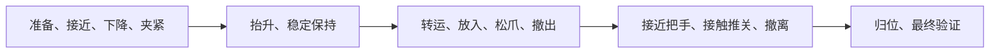

<a href="README.md"><kbd>English</kbd></a> <a href="README.zh-CN.md"><kbd>中文</kbd></a>

# SkillWeave Sim

机器人仿真项目：保留 Panda 参考实现，并单独推进 G1/MuJoCo 验证路线。

## G1 主线：真实 planner → 审批 → 人工技能，尚非 VLA

最终真机目标是 Unitree G1 EDU＋双 Dex1。当前 `work/g1-baseline` 分支已把真实订阅 planner 接到**人工编码的右臂抬升—保持—回位技能**。模型只提议一次固定宏动作；内部阶段是人工编写，不是学习或独立规划的技能。具体协议与结果见 [G1 执行记录第 12 节](G1_BASELINE_PLAN.zh-CN.md#12-真实-planner-接入人工技能与实测反馈)。

G1 源码以 Git 子模块固定在 `a5e40a25c5c080ae114a925dae94215c7cb6d793`。只初始化下面两个场景资产，不再依赖主目录里的旧工程，也不需要初始化真机 SDK：

```sh
git clone --branch work/g1-baseline https://github.com/youseihuayu-wonderful/SkillWeave-Sim.git
cd SkillWeave-Sim
uv sync --locked
git submodule update --init third_party/g1-vla-control
git -C third_party/g1-vla-control submodule update --init third_party/mujoco_menagerie third_party/dex1_1_service
uv run --locked python g1_scene_preview.py --port 8778
```

打开 http://127.0.0.1:8778/ 。规划需要 `PATH` 中的官方 Codex CLI，并通过 **`codex login` 登录 ChatGPT 订阅**；复用 `planner.py`，没有 API 密钥回退。本轮请求模型标识为 `gpt-5.6-terra`，不代表已证明服务端权重快照。

1. 输入 `请抬起右臂，保持一秒，然后回到原来的位置。`，点击 **请求真实 GPT 规划**；此时不会执行技能。
2. 核对提案绑定的原始任务、实际回复和提案编号，再点 **批准当前提案并执行**，只授权一次固定技能。
3. 查看本地实测终态与另列的真实模型反馈。运动中点击 **取消规划 / 物理停止**会继续物理积分直到实测停稳；停止不算任务成功。

规划、待审批和结果评估期间有意暂停仿真时钟，不能作为真机时序或观测新鲜度证明。会话期间锁定改变场景的控制；技能终态后须显式复位。超出能力的完整请求被拒绝，不部分替代。模型只读取结构化状态，不看相机、不生成电机目标；VLA／真机仍禁用。**独立手动基线 / 空闲预览**保留无模型技能入口，绝不是规划失败自动回退。原来的 `server.py` 与下文命令仍是 Panda 参考实现。

[实际审批／物理执行录像](media/g1-planner-approved-skill.mp4) · [真实页面结果与反馈](results/g1_planner_ui_approval.json) · [物理停止及反馈录像](media/g1-planner-physical-stop.mp4) · [真实页面停止结果](results/g1_planner_ui_stop.json)。

独立真实运行已验证[成功执行](results/g1_planner_success.json)、[完整拒绝手机拍照复合请求](results/g1_planner_unsupported.json)、[物理停止](results/g1_planner_stopped.json)、[真实注入碰撞失败及模型反馈](results/g1_planner_collision_failure.json)。页面另[完整拒绝保持五秒](results/g1_planner_ui_guards.json)，冲突控制拒绝证据见上方页面执行记录。自动化首次两秒等待在审批前提前结束；随后继续同一个未审批提案完成停止验证，没有重新请求规划。

**27 项定向规划契约测试通过**；其中受控模型／执行器替身不算真实模型或物理运行证据。此前[手动技能录像](media/g1-scripted-arm-baseline.mp4)与 9 项真实模型回归单独保留。物理控制器未改动：运行时只改变执行器命令并推进 MuJoCo，不写运动中的真实关节位置、不播放录像、不焊基座、不改增益、不绕过接触检查。

原有 [VLA 首目标诊断](results/g1_first_target.json)仍是独立离线结果。这次单宏动作接入不代表通用任务拆解、人类视频理解、手机拍照、神经模型堆叠、完整 raw32 回放、满足实时观测预算或真机安全认证。模型原文不能覆盖本地失败／停止结果；实测低速停稳不代表碰撞已经解除。

生成新的本地证据，不覆盖已提交记录：

```sh
uv run --locked python g1_baseline_manifest.py --output results/local_g1_manifest.json
uv run --locked python run_g1_planning.py --output results/local_g1_proposal.json
uv run --locked python run_g1_planning.py --execute --output results/local_g1_planned_raise.json
uv run --locked python run_g1_planning.py --execute --stop-after-s 10.5 --output results/local_g1_planned_stop.json
uv run --locked python -m unittest discover -s tests -p 'test_g1_planning.py' -v
```

再次运行时选择尚不存在的输出路径。不带 `--execute` 只请求真实提案，不推进物理；`--execute` 明确批准本次实际绑定的提案。证据原子新建、不覆盖旧记录。启动时检查源码提交、已跟踪文件字节与场景资产；[本轮源码／环境清单](results/g1_planner_manifest.json)包含 planner、执行器、页面与测试 SHA。清单进程自身不调用模型或机器人，执行证据以上述独立记录为准。配套 checkpoint、同步 author32 包、GPU 运行证据和场景标定仍缺，正式神经模型基线未解锁；上游神经闭环与禁止执行标志保持不变。

## 继承的 Panda 参考项目：身份与范围

本项目独立克隆自 [Intelligent Grasping](https://github.com/youseihuayu-wonderful/Intelligent-Grasping-Predicting-Success-and-Selecting-Approach-Speeds-of-Robotic-Arms)，起点为来源提交 [`efc0f0650530d2216e7cd2601a85557778834371`](https://github.com/youseihuayu-wonderful/Intelligent-Grasping-Predicting-Success-and-Selecting-Approach-Speeds-of-Robotic-Arms/commit/efc0f0650530d2216e7cd2601a85557778834371)。原仓库保持不变。

- 新仓库：https://github.com/youseihuayu-wonderful/SkillWeave-Sim
- Panda 参考分支：[`work/skillweave-sim`](https://github.com/youseihuayu-wonderful/SkillWeave-Sim/tree/work/skillweave-sim)。
- 机器人：Franka Panda 七轴单臂与双指夹爪，不是 Unitree G1。
- 初始任务：抓取黑碗，放入已经打开的底层抽屉，支撑放置并松爪，撤手，接触推关抽屉，最后空手归位。
- 复用能力：MuJoCo 动力学与渲染、五项有边界的收纳技能、物理后置条件检查，以及现有 ChatGPT 订阅规划接口。固定执行不需要调用模型。
- 本次克隆不包含人的示范视频理解、VLA/π0.5 动作控制或手机拍照功能。

下文的视频、实验记录、模型引用和历史项目名称均为继承的来源证据，不是 SkillWeave 新做的实验。历史视频 1 是一次提案获批后的固定执行，不冒充逐项 GPT 闭环录像。

## 启动继承的 Panda 仿真

```sh
git clone https://github.com/youseihuayu-wonderful/SkillWeave-Sim.git
cd SkillWeave-Sim
git switch work/skillweave-sim
uv sync --locked
uv run --locked python server.py --port 8765
```

浏览器打开 http://127.0.0.1:8765/ 。这里运行的是真实本地仿真；GitHub 中的视频只是录像。继承的 GPT 模式还需要按下文配置 ChatGPT 订阅登录。

不打开浏览器、不调用 GPT，也可以执行五技能物理收纳流程：

```sh
uv run --locked python simulation.py \
  --skill grasp_and_hold place_and_release withdraw_from_drawer close_drawer return_home \
  --initial-opening-mm 80 --descent-speed-mm-s 200 --close-trigger-height-mm 4
```

## 新项目实际运行验证

已在本次新克隆中执行上述五技能命令：`store_and_home` 的全部目标检查均为真，最终技能状态为 `succeeded`，意外碰撞记录为零。最终仿真时钟为 66.54 秒；这不是实际墙钟耗时，也不是提速对照。

这是一次不调用 GPT 的无画面固定技能流程验证，不是统计成功率、新 planner 评测或 VLA／视频理解能力证明。

## 中英文阅读与界面切换

仓库首页默认显示[完整英文说明](README.md)，本文件保留完整中文版；GitHub 文档通过上方链接切换，不运行页面脚本。G1 技能仪表盘当前为中文。继承的 Panda 实时页面提供全局“English / 中文”切换，覆盖收纳和分拣界面；首次打开默认英语，偏好仅保存在当前浏览器的本地存储（`gpt-ui-language`），不上传到服务端。

切换仅改变展示，不推进、重置或执行物理仿真，也不发送规划、批准或模型请求；不会覆盖已编辑的任务草稿。原始用户／GPT 文字、JSON、日志、轨迹和历史视频保留原貌，并与翻译后的结构化说明区分；英文说明不意味着历史中文任务曾用英文重新运行。Level 1 验证记录默认提供[英文版](results/grasp_level1_verified_20261104/record.md)，另有[中文版](results/grasp_level1_verified_20261104/record.zh-CN.md)。

界面实测：完整黑碗固定收纳流程与六物体固定分拣均在真实 MuJoCo 执行中成功完成。暂停物理仿真后往返切换语言，物理状态与已编辑草稿保持不变，未发送控制或模型请求；也验证了语言偏好记忆及存储被阻止时的明确提示。这些界面检查不是新的分类器实验或 GPT 对照试验。

## 可分享的 Level 1 成果文件

**[Active Learning for Adaptive Grasp Speed Selection — 全英文 PDF](Active%20Learning%20for%20Adaptive%20Grasp%20Speed%20Selection.pdf)**

四页报告包含实际场景、真实标签采集、分类器特征、三档预测、物理执行结果、计时、教授三个问题的回复和复现命令；明确区分已经证明的工程可行性与尚未证明的主动学习、选速收益。

## 两段独立视频

下面是两个不同场景的独立录像，分别播放，不拼接：第一个做黑碗入屉与关屉，第二个只做彩色碗杯分拣。视频来自真实 MuJoCo 执行，不是 GitHub 页面内在线运行的仿真。

两个播放器均使用原始录像的**全英文展示版**。保留物理动作、每帧展示时间戳、等待批准和结尾停留，按原速播放；仅修改展示，不是新的仿真或 GPT 请求。原语言录像另以明确标注的历史归档链接保留。

### 视频 1：黑碗放入抽屉 → 关闭抽屉 → 机械臂归位

抓取黑碗、移到已打开的下层抽屉、支撑放置并松爪、撤出夹爪、接触推关抽屉，最后空手归位。这里的黑色容器实际是碗，不是彩色杯子。

https://github.com/user-attachments/assets/54fb89f5-286b-4bee-9c07-fc46bf98d2e4

[下载全英文 MP4](media/grasp-demo-en.mp4) · [对应物理验收记录](results/subscription_storage.json) · [英文编辑来源记录](results/storage_video_english.json)

[原始录像归档（中文界面）](media/grasp-demo.mp4)

这是一段约 **1 分 29 秒**的完整历史收纳录像，包含关屉、归位和成功画面；一次订阅提案获批后执行固定收纳流程，不冒充逐项 GPT 闭环录像。

### 视频 2：彩色碗杯分拣 · 六物体真实接触执行

红、蓝、黄三色各一只碗和一只杯，共 **3 碗＋3 杯**。GPT 完整提案获批后，本地控制器依次完成真实夹持、抬升、转移、支撑放置和松爪；六件全部验收后空手归位。本场景没有抽屉，也不执行关屉动作。

https://github.com/user-attachments/assets/cee405f9-fdad-46d8-a424-0cd2fd8d7e7d

[下载全英文 MP4](media/gpt-sorting-contact-feedback-demo-en.mp4) · [对应提案与物理验收记录](results/gpt_sorting_contact_feedback_demo.json) · [英文编辑来源记录](results/sorting_video_english.json)

[原始录像归档（中文界面）](media/gpt-sorting-contact-feedback-demo.mp4)

录像约 **8 分 29 秒**，包含等待批准及展示停留；物理任务耗时为 **197.786 仿真秒**。录像时长不能当作机器人执行耗时，也不与第一个视频拼接比较。

### 重新生成英文展示文件

以下独立脚本读取历史录像和已验证结果，不运行 MuJoCo、不训练模型、不请求 GPT。各渲染脚本的 `--help` 提供字体路径覆盖选项。

```sh
uv run --script render_storage_video_en.py
uv run --script render_sorting_video_en.py
uv run --script build_grasp_speed_report.py
```

[展示文件验证记录](results/english_presentation_verification.json)包含全帧时间戳核对、抽样语言检查、实际浏览器播放和上传附件检查。

## 项目与实验说明

为 GPT 高层任务规划提供真实物理执行能力。默认收纳场景通过当前 ChatGPT 订阅，每轮从五项本地技能中选择**一个动作**，执行后把实际结果送回 GPT。独立分拣场景支持**一次生成完整六物体提案，核对并批准后执行**，同时保留无模型的固定规则对照。两种规划粒度不同，不混称闭环重规划。不需要 API 密钥，没有固定模型回复、物体绑定或动画平移；尚未加入视觉识别或 DP。

仓库：https://github.com/youseihuayu-wonderful/SkillWeave-Sim

默认收纳场景包含 Franka Panda 七轴机械臂、双指夹爪、桌面、黑碗、酒瓶、三层抽屉柜、酒架。浏览器画面由正在运行的 MuJoCo Renderer 生成，不是视频或预录轨迹回放。物体位姿直接取自仿真器。另有下述独立彩色碗杯分拣场景，支持 GPT 提案与固定规划。

原收纳项目的实施顺序：

1. 搭建仿真场景：已完成，读取物体真值位姿。
2. 固定脚本抓取：已完成，保留顺序执行 baseline。
3. 参数化抓取与时序控制：已完成，支持真实运动重叠及固定场景参数小实验。
4. GPT 规划层：从整段固定阶段说明升级为单步技能决策、真实执行、状态反馈闭环；可逐步确认，也可明确授权后连续执行。
5. 对比验证：已完成 72 组多目标扩展配对；针对其中一次错误拒绝，补全抽屉观测后另做 36 组回归并通过约定验收。新旧批次与历史 54 次抓取、21 组原始闭环、10 组补充闭环均独立保留，不覆盖失败或混算完成率。

收纳场景的五项技能可在同一仿真中独立调用，无需重置。该模式的 GPT 根据每轮物理状态选择技能；初态已持物时不必重新抓取。可选技能和终点均有限，这不是开放式机器人代理。

## Proposal Level 1：抓取速度分类与真实执行

使用上方第一个视频的原收纳工位，但只做黑碗／酒瓶的抓取、抬升与连续 2 秒保持，不混入入屉、关屉或六物分拣。新增的本地随机森林负责三档下降速度的预测与选择；这一步不使用 GPT、27B、MRIoC 或付费接口。

已完成真实正负采集、训练、先保存三档预测再实际执行建议，并按同一冻结协议复验。**工程流程可行，但本批模型建议没有优于固定最快档；尚未验证主动学习或 D-optimal 的采样优势。** 建议与固定最快档均为 **16/18** 成功，成功任务平均耗时分别为 **13.010 与 12.634 仿真秒**，不构成学习提速优势。具体样本数、计时、错误预测、失败阶段与研究边界见[简短验证记录](results/grasp_level1_verified_20261104/record.zh-CN.md)和[原始汇总](results/grasp_level1_verified_20261104/summary.json)。

```sh
uv sync --locked
uv run --locked python run_grasp_learning.py --output results/grasp_level1_reproduction
```

输出目录必须不存在。入口为 [`run_grasp_learning.py`](run_grasp_learning.py)，物理标签采集器为 [`grasp_trial.py`](grasp_trial.py)，模型与选速规则为 [`grasp_speed_model.py`](grasp_speed_model.py)。每批保留协议、源码／资产指纹、模型、逐次物理轨迹、预测与真实结果；无效初态不当作失败，内部／数值异常中止并保留当前尝试信息，不覆盖旧证据。

原实时页面仍由 `server.py` 提供，可显示黑碗／抽屉工位；页面不会自动加载这些随机森林建议。本轮模型执行走上述无画面批量入口，不把旧演示视频当作学习实验。

## 彩色碗杯分拣：GPT 提案与固定规则对照

两个终端分别启动后端与右侧实时页面：

```sh
uv run python server.py --scene sorting --port 8766
```

```sh
terminal-browser open http://127.0.0.1:8766/ --split right --size 0.48
```

### GPT 提案、批准与执行

`sorting_planning.py` 使用与收纳模式共用的订阅传输层。点击“请求 GPT 完整提案”只调用当前 Codex 的 ChatGPT 订阅，不移动机械臂；核对返回的映射、六件物体顺序与提案编号，再点击“批准所示提案并执行”。模型可更换颜色到 A/B/C 的一一映射和处理顺序，每色的一碗一杯必须同区；碗固定使用该区前排落点，杯使用后排落点，坐标、速度、力及底层轨迹均不由模型生成。

本地校验能证明计划完整、身份和落区合法、物理前置条件满足，**不能证明模型正确理解了任意自然语言**。批准的是实际展示的提案，而不是一段未核对的任务文字。批准时再次检查场景版本、位置与姿态漂移、机械臂及夹爪状态；过期、无效、拒绝或失败的提案不会执行，也不自动改跑固定队列。执行期间锁定目标，不再次调用 GPT、不重试、不在线改变计划。初始物理时钟是否暂停取决于页面控制；批准会恢复时钟。取消只用于等待请求或待批准阶段；执行中使用暂停或显式重置。

接口为 `sort_plan`（`task`）、`sort_execute`（整数 `decision_id`）、`sort_cancel`。原 `sort` 仍执行固定基线；GPT 尝试后必须显式重置才能切换，避免自动抹掉失败历史。错误启动若已改变控制器状态，或出现未知启动异常，会锁定服务运行错误、停止物理时钟，要求重启，而不是当作普通拒绝继续运行。订阅取消与超时重叠时也必须完成子进程组终止和回收。

### 首轮实测对照与动态演示（接触反馈修正前）

[`compare_sorting.py`](compare_sorting.py) 在两项预先声明的目标上分别运行固定规则与真实 GPT：每对使用同一模型和相同的初始位置、速度、控制量、约束、外力及求解器预热状态。固定规则接收结构化映射/优先级，GPT 接收相应任务文字；两者都使用相同控制器，不把旧固定颜色队列强行用于新目标。自动验收仅批准与预先声明目标相符的模型提案，绝不修补错误回答。

| 任务 | 方法 | 正确放置 | 执行仿真秒 | GPT 请求墙钟秒 |
|---|---|---:|---:|---:|
| 红 A、蓝 B、黄 C | 固定规则 | 6 / 6 | 183.356 | 不调用 |
| 红 A、蓝 B、黄 C | GPT | 6 / 6 | 183.356 | 7.188 |
| 红 B、蓝 A、黄 C，杯先于碗 | 固定规则 | 6 / 6 | 195.518 | 不调用 |
| 红 B、蓝 A、黄 C，杯先于碗 | GPT | 6 / 6 | 195.518 | 8.175 |

四次运行均无意外碰撞，并通过完成后的独立 5 仿真秒保持。数据见[完整配对记录](results/sorting_planning_comparison.json)。本批次另有[独立顺序审计](results/sorting_planning_order_audit.json)：绑定原记录 SHA-256，仅从保存的接触力、离桌高度、释放和稳定支撑观测重建抓放顺序，不从控制器阶段、索引或完成日志推断；这是原轨迹的事后审计，不是新增执行。当前验收器已在执行时直接检查这些顺序约束，采样不足则不能通过。

**本轮证明了自然语言可以转成可执行的受约束分拣提案，没有证明 GPT 提速或优于固定规则。** 两项任务中 GPT 选择了与规则相同的队列，物理耗时相同，另有真实请求等待。只有两项已知布局目标，不是随机场景成功率或泛化研究。等待 GPT 时无界面对照仍推进物理；执行阶段为加速无界面运行，墙钟耗时不是实物产能，也不能与仿真秒直接相加。

[真实 GPT 分拣演示 MP4](media/gpt-sorting-demo.mp4) · [提案、终态及调用证据](results/gpt_sorting_demo.json)。这段独立浏览器演示使用“红 B、蓝 A、黄 C，杯先于碗”，真实请求约 5.861 墙钟秒，物理任务约 195.52 仿真秒，6 / 6 完成。请求模型标识为 `gpt-5.6-terra`，不代表已证明服务端模型权重快照。录像为 1440 × 1080、H.264、约 635 秒，包含暂停等待批准及完成后的停留；不是任务耗时测量，也不计入上述四次配对。

```sh
uv run python compare_sorting.py --output results/sorting_comparison_new.json
uv run python -m unittest discover -s tests -v
```

报告文件必须不存在；异常和中断保留已产生记录，不覆盖旧失败。范围仍限六个已建模物体、已知工位、三色独占三个区；不支持摄像头识别、混色同区、同色分区、堆叠、传送带或任意新物体。结构校验允许不同顺序，不等于所有顺序都已有物理成功证明。

### 放置末段的有界接触反馈

六种颜色映射的物理回归曾发现两项队列失败：黄色碗移到 A 区时，原位置轨迹结束后仍有约 0.1 mm 的真实离桌间隙，没有正向桌面支撑，控制器因此停止而非提前松爪。[两次原始失败状态](results/sorting_placement_failures_before_fix.json)从首次失败的全量测试输出提取，保留原队列、物理诊断和失败原因，不是重跑，也不被后续成功覆盖。

修正只作用于放置末段：原轨迹正常到位但仍无支撑时，保持夹持，从当前实测 TCP 开始以 **2 mm/s 的目标速度、最多 3 mm、最多 2 s**寻找桌面支撑。检测到正向支撑立即停止下降，再使用原稳定支撑／释放判据。关节目标变化仍有速率限制，失抓、落点占用和意外碰撞检查保持有效；无支撑则明确失败，不修改物体尺寸、质量、摩擦、位姿或成功阈值。这不是提高整段搬运速度。

[黄色碗→A 的针对性实测](results/sorting_support_search_smoke.json)实际触发了 0.816 mm 的接触搜索目标增量；释放后桌面支撑力约 0.450 N，正确区域、落点、直立、静稳与脱离夹爪均由独立观察确认，模型指纹保持不变。该记录只验证这一次放置，不把尚未完成的整批物体计作成功。

### 修正版浏览器演示

[完整全英文动态 MP4](media/gpt-sorting-contact-feedback-demo-en.mp4) · [真实提案与最终物理状态](results/gpt_sorting_contact_feedback_demo.json)。任务要求“黄 A、蓝 B、红 C，先碗后杯、黄碗优先”；GPT 实际提出黄碗、蓝碗、红碗、黄杯、蓝杯、红杯。提案期间暂停且没有启动技能，核对映射和优先级后明确批准；六件全部完成、空手归位，内置整批保持 5 仿真秒，无意外碰撞。执行耗时 **197.786 仿真秒**，真实订阅请求 **9.508 墙钟秒**，请求型号仍为 `gpt-5.6-terra`。

该演示不计入配对对照。原始录像为 1440 × 1080、H.264、平均约 5.96 fps；英文版为 1280 × 960，完整保留 509 秒展示时间线，包括等待批准和成功后停留。浏览器自动化的终态等待提前超时，但物理执行正常继续，随后观察到真实成功再暂停并结束录制。录像时长不是任务计时，也不把它称为独立的额外保持实验。

当前服务的实际界面检查还包括：390 px 下分拣初态、完整提案和成功终态无页面横向溢出；原收纳模式仍可由页面实际执行 `grasp_and_hold` 并满足全部持物判据，报告切换不改变暂停现场。两个模式的检查均未出现浏览器错误。

### 修正版配对复验（独立批次）

接触反馈与在线物理顺序验收加入后，使用相同两项目标重新运行固定规则和真实订阅 GPT，另存[修正版完整配对记录](results/sorting_planning_comparison_contact_feedback.json)，不覆盖首轮：

| 任务 | 固定规则执行 · 仿真 s | GPT 执行 · 仿真 s | GPT 请求 · 墙钟 s | 物理验收 |
|---|---:|---:|---:|---|
| 红 A、蓝 B、黄 C | 183.356 | 183.356 | 6.916 | 两者均 6 / 6 |
| 红 B、蓝 A、黄 C，杯先于碗 | 195.604 | 195.604 | 8.886 | 两者均 6 / 6 |

四次均通过独立的抓放顺序检查与完成后额外 5 仿真秒保持，无意外碰撞。两对的初始物理状态及编译模型匹配；GPT 仍选择与规则相同的队列，仍没有执行提速。第二目标的耗时与首轮不同，因此不沿用旧控制器的 195.518 s 作为新版结果；不同批次不合并为成功率或吞吐量。

最终执行 `uv run python -m unittest discover -s tests -v`，**238 项全部通过**，原始输出见[完整回归日志](results/gpt_sorting_tests.log)。其中六种颜色映射各执行一条预先定义的重排队列，真实抓放、整批归位、独立目标检查与模型不变检查均通过，包含修正前失败的两条路径；这不是穷举所有物体顺序或未知布局成功率。协议测试中的受控提供方替身不算真实 GPT 调用，真实订阅证据仅来自上述独立实验和浏览器演示。

### 冻结版本：新位置与等价任务表述

[`sorting_evaluation_protocol.json`](sorting_evaluation_protocol.json) 已在执行前以提交 `1b477b1` 预注册。控制器、规划提示、物理资产、MuJoCo 版本、基线策略及请求模型标识冻结于 `8941027` 对应的版本；本轮不根据结果修改速度、接触搜索或抓取参数。

- **4 个新布局 × 2 种等价表述 × 2 种方法 = 16 格，每格一次。** 布局分别为 X 平移 18 mm、Y 平移 −24 mm、交错位姿、交换颜色列。坐标是人工预先指定的，不是随机抽样；两种文字在同布局下的颜色目标和杯优先约束完全相同。
- 固定规则接收结构化目标，GPT 接收自然语言与真实仿真状态；同一布局的四次执行必须具有完全一致的初始物理与编译模型指纹。两者使用原控制器，不能将差异解释为底层模型或速度不同。
- 仅在初始化或显式重置时设置预注册位姿，再通过普通物理步进落稳。正常执行不改物体位姿、质量、碰撞体、约束或外力，不绑定物体，不自动重试或切换规则。
- 按物理接触、抬升与放置顺序、正确区域和落点、稳定支撑、空手归位、内置及独立额外保持判定。未测量耗时保留为空；提前失败不算更快，只对两种方法都成功的配对计算耗时差。
- 明确的模型拒绝、无效提案、目标不匹配或物理失败保留并继续；配置、未知提供方／内部错误、配对、冻结、清理或证据保存错误中止整批。中止与“全部已执行但有任务失败”分开记录，不把它们冒充通过。

历史分拣复现须在独立工作区使用提交 `a30e4e8ee40aea3c579b6668edb661a1373a76bd` 及其锁文件，再运行下列命令。本次 Level 1 新增了分类器依赖并收紧 IK 异常处理，当前工作区不再匹配旧分拣协议的冻结指纹；拒绝混用是预期保护，不修改旧协议哈希或覆盖历史失败。复现另存目录：

```sh
uv run python evaluate_sorting.py --output results/sorting_frozen_evaluation_reproduction

# 实时查看指定布局；不自动运行评估或请求模型
uv run python server.py --scene sorting --sorting-layout swapped_columns --port 8766
```

每批保存原样协议、原子更新的 `summary.json` 和逐次完整 `runs/*.json.gz`，记录 SHA-256、实际提案、请求线程、物理轨迹和失败原因。输出目录必须不存在；不恢复未完成批次或用后来的成功替换失败。请求标识 `gpt-5.6-terra` 不等于服务端权重快照证明。

分拣页面的“冻结版本分拣 · 独立评估存档”只读取正式目录 `results/sorting_frozen_evaluation`。刷新和下载不请求 GPT、不重置或驱动机械臂；缺失或无效报告明确报错，不退回旧报告。该存档与上方实时场景相互独立，选择复现输出目录不会自动替换页面所读批次。

本轮评测程序提交为 `2e37b8b`。正式执行前，`uv run python -m unittest discover -s tests` 的 **285 项检查全部通过**，见[完整回归输出](results/sorting_frozen_evaluation_tests.log)。其中评测故障回归先复现了七项失败，再验证修正后的行为；日志中的内部错误为受控故障注入，不是真实模型调用失败。[运行环境与程序指纹](results/sorting_frozen_evaluation_environment.json)单独保存。

正式批次已完成，见[完整汇总](results/sorting_frozen_evaluation/summary.json)、[执行时的协议副本](results/sorting_frozen_evaluation/protocol.json)和[逐次完整物理轨迹](results/sorting_frozen_evaluation/runs)。下表仅统计这一批，不与历史演示或修订前的结果合并：

| 方法 | 成功／尝试 | 平均执行 · 仿真 s | 平均执行 · 墙钟 s | 平均 GPT 请求 · 墙钟 s | 平均端到端 · 墙钟 s | 意外碰撞事件 |
| --- | ---: | ---: | ---: | ---: | ---: | ---: |
| 固定规则 | 8/8 | 191.947 | 179.442 | — | 180.228 | 0 |
| GPT（真实订阅） | 8/8 | 193.284 | 229.339 | 9.726 | 239.967 | 0 |

每次都完成六物体分拣、空手归位和控制器内置 5 s 保持，并通过独立额外 5 s 物理保持检查。八个 GPT 请求具有不同的线程标识；四个布局各自的四次执行初态指纹一致。执行后冻结检查通过，16 份 gzip 均已解压、核验 SHA-256，并核对原始计划、真实抬升／放置顺序、接触证据和最终观测与汇总一致；没有重试、删去失败或修改冻结控制器。

**本轮证明的是受限新布局和等价表述下的可执行性，不是 GPT 优于规则。** 未观察到成功率、碰撞或执行时间优势；GPT 与规则共用底层控制器，本机墙钟包含模型等待及计算开销，不能当作真实机器人速度。每格仅一次、布局人为预先指定，也不能据此声称统计泛化能力。首页的两段视频仍是此前各自场景的录像，不冒充本轮评测录像。

完成态报告已在浏览器实际验证：2 行方法总账、16 行逐次记录、8 行配对；390 px 窄屏无页面横向溢出，表格可单独横向滚动。已点击下载完整 gzip，下载文件的 SHA-256 与存档一致；刷新和下载前后暂停的完整仿真状态一致，无浏览器脚本错误。

### 固定颜色分拣基线（不调用 GPT）

`sorting.py` / `sorting_scene.xml` 提供同一物理执行器与原固定规划基线；`sorting_contract.py` 定义独立物体身份和完整不可变计划，不改变原收纳模式。红、蓝、黄三色各有一只碗和一只无把手空心杯；颜色、身份和位姿来自仿真真值，不是视觉识别。杯底使用固定质量的复合盒碰撞近似，圆形底面渲染几何不参与碰撞；杯壁保持空心。碗复用原碰撞资产，只改变显示颜色。

固定全队列为红碗、红杯、蓝碗、蓝杯、黄碗、黄杯；红色到 A 区、蓝色到 B 区、黄色到 C 区。每区有两个独立落点，不堆叠。区域是桌面标记，不是带壁容器。每件依次准备、接近、下降、双侧夹持、抬升保持、转移、支撑放置、释放、撤离，全部完成后机械臂归位并连续验证 5 仿真秒。

本次已完成固定布局的真实正向运行：六件物体均观察到双侧夹持与离桌抬升，全部正确放置并归位，控制器任务耗时 **183.356 仿真秒**，意外碰撞为 0；独立验收在完成后又保持并观察 **5.000 仿真秒**。这是已知场景的执行证据，不是成功率估计或实物设备产能。

[完整实时分拣录像 MP4](media/fixed-sorting-demo.mp4)：1440 × 1080、H.264，录制约 303.13 墙钟秒，包含操作及结束后的停留。本机渲染与并行计算影响播放进度；不能用录像时长代替任务仿真时间或声称实时吞吐量。录像展示正向队列；故障停止与成功撤销由单独的物理回归检查验证。

录像结束后保存的[现场物理状态](results/sorting_demo.json)与独立无界面验收分别记录；不将它们当作多场景成功率实验。


点击“运行固定分拣对照（不调用 GPT）”执行原完整队列；运行中支持暂停、单步和显式重置。开始前要求六件物体稳定支撑、夹爪空闲、机械臂归位且预留落点未被占用。重复启动、与 GPT 会话冲突的请求及本场景中的旧收纳命令会拒绝，不会暗中切换任务。重置会实际推进 0.6 仿真秒让场景落稳，保留这段时间，不伪造零速度。模型与物体在正常执行期间不重置、不瞬移、不附着到夹爪。

完成判据包括完整碰撞边界进入目标色区、对应落点、直立、正向桌面支撑、静稳、脱离夹爪和最终归位。每件与整批的完成状态持续复核；失抓、意外碰撞、已完成物体受扰、数值错误或超时均停止，不能跳过失败继续。页面的 0–6 进度是当前物理验收结果，不是统计成功率。

独立验收使用真实接触力、物体碰撞边界、关节与物体状态；每件必须实际出现双侧夹持和离桌抬升。控制器完成后，验收器另行观察整批目标保持 5 仿真秒，并在每次 20 ms 观察步检查物理参数、等式激活及外力。轨迹按 100 ms 或阶段变化保存，有限采样不是每个内部求解操作的审计。已有记录：[`results/sorting_verification.json`](results/sorting_verification.json)。

```sh
uv run python verify_sorting.py --output results/sorting_run_01.json
uv run python -m unittest discover -s tests -p 'test_sorting.py' -v
```

输出文件必须尚不存在，防止覆盖旧失败。报告区分仿真时间与加速无界面执行的墙钟时间，后者不能当作实时产能。测试还覆盖落点被占用、重复启动不改物理状态、外力失抓停止、成功受扰后撤销，以及数值故障必须重置。上述历史固定基线记录不调用 GPT，不是可变规则或跨场景泛化结论；新增 GPT 分拣能力与独立证据见上节。

## 历史逐项闭环录像与验证记录

首页的两段独立播放器用于分别展示完整收纳和六物体分拣。下面保留历史逐项闭环的分段记录，不作为第三个首页播放器，也不与分拣视频混合。

[五技能执行 MP4](media/gpt-closed-loop-demo.mp4) · [继续同一现场确认完成与额外保持 MP4](media/gpt-closed-loop-validation.mp4) · [原始请求、物理状态与验收证据](results/expanded_demo.json)

扩展批次的这段历史演示真实使用 `gpt-5.6-terra` 订阅请求：依次选择抓取保持、放置松开、撤出夹爪、关抽屉、归位，再提出 `complete`，不是一次请求生成整段固定动画。所有技能均由 MuJoCo 物理执行；末尾全部收纳判据为真，额外验证保持 **5.05 仿真秒**，无意外碰撞。此独立演示不计入重复对照矩阵，也不冒充后续状态补全修订的录像。

录像为两段：第一段 118.37 s，末帧仍显示归位技能执行中；第二段 6.07 s，在**同一现场**继续本地确认和保持，无重置、技能重跑或额外 GPT 请求。段间操作间隔未录制，不能声称这两段连续覆盖了全部动作，也不能把时长相加作为端到端实验耗时。MP4 为 1440 × 1080；[第一段 GIF 预览](media/gpt-closed-loop-demo.gif)为 720 × 540、6 fps 原速预览。仿真秒与录像墙钟秒不是同一个时钟。

### 历史固定任务录像

[历史 MP4](media/grasp-demo.mp4) · [历史 GIF](media/grasp-demo.gif) · [历史终态证据](results/subscription_storage.json)

历史录像包含一次订阅规划、预览和固定收纳，不是逐项 GPT 闭环；保留供追溯。成功必须同时满足碗完全入屉、底面支撑、夹爪脱离、抽屉关闭和机械臂归位。上述录像均不是 GitHub 服务器上运行的仿真，不代表跨场景成功率或 GPT 优于规则。


## 启动与右侧显示

先克隆仓库，再安装锁定的依赖（需要 Python 3.12 和 [uv](https://docs.astral.sh/uv/)）：

```sh
git clone https://github.com/youseihuayu-wonderful/Intelligent-Grasping-Predicting-Success-and-Selecting-Approach-Speeds-of-Robotic-Arms.git intelligent-grasping
cd intelligent-grasping
uv sync --locked
uv run python server.py --port 8765
```

服务仅监听 `127.0.0.1`。另一个终端中执行：

```sh
terminal-browser open http://127.0.0.1:8765 --split right --size 0.48
```

也可以直接在浏览器打开 http://127.0.0.1:8765 。服务停止后重新执行启动命令，再点击页面的“重新连接”。物理仿真与手动 baseline 不依赖外部模型或 GPU 服务；GPT 规划需要下述 Codex CLI 与有效的 ChatGPT 订阅登录。

- 运行固定 baseline：以 80 mm 开口、100 mm/s 名义下降速度、0 mm 提前闭合执行。运行中不能重复启动；固定任务再次运行需重置。
- 运行自定义参数：校验并使用三个输入值，自动开始物理积分。编辑输入框不会改变正在执行的参数；“实际应用”显示后端采用的配置。
- 运行完整固定任务：不用 GPT，以 baseline 抓取参数执行收纳、关柜和归位；不是失败后的自动兜底。
- 实验表中的“填入参数”只填表，不启动或重置；“刷新报告”读取最新保存的真实实验结果。
- 独立本地技能：从列表选择技能，查看实时前置条件与完成判据，再单次启动。只有抓取技能使用参数输入框；成功后可选择下一项，不自动串联、不调用 GPT。失败后必须重置。
- 暂停／开始运行：停止／继续物理积分。
- 单步：暂停时推进 20 ms，即 10 个 2 ms 物理步。
- 重置：取消未完成的规划、作废旧计划，恢复物理初态、后端默认参数并清空计时，暂停仿真；页面输入值保留，便于再次执行同一配置。
- 视角：全景、正面、俯视。
- 没有浏览器连接时不推进物理；多个页面共享同一个仿真实例与控制状态。
- 画面目标更新频率为 20 Hz。显示的是仿真时间，不是宿主机墙钟时间；机器负载可能降低实际播放速度。

## 五项独立技能：本次第 1 步

对应会议纪要第 3、5 页的“先确认控制接口与动作协调能力”，以及第 4 页的仿真合理性检查。第 6 页的状态／动作／时间戳保存属于整理者补充建议，本项目采用该建议形成验收记录，不将其冒充已定稿的算法或 benchmark。

| 技能 | 必须具备的起始条件 | 完成后留下的状态 |
| --- | --- | --- |
| `grasp_and_hold` | 空夹爪在支持的高位；选定黑碗／酒瓶在桌面稳定 | 实际抬升、双侧夹持并保持；不自动放置 |
| `place_and_release` | 已验证稳定持有黑碗；抽屉全开且原尺寸适合通道 | 碗完整入屉、真实支撑、已松爪且稳定；手仍在抽屉内 |
| `withdraw_from_drawer` | 碗支撑、静稳、脱离；手位于支持的放置交接区域 | 手部退出抽屉运动区域并到达高位；不自动推关 |
| `close_drawer` | 抽屉全开、无物体阻挡；空夹爪在已验证高位 | 通过真实把手接触关闭抽屉并撤离；不自动归位，也不要求碗必须先入屉 |
| `return_home` | 空夹爪已撤离并处于已验证高位回程区域 | 关节位姿和速度满足 home 判据；不改变抽屉目标 |

原资产、物体尺寸、质量、摩擦和执行器限制保持不变。独立关空抽屉时，原中心接触路径会让手掌碰到仍在桌面的碗；现在统一使用测得把手右端以内 14 mm 的接触点，而不是移走碗或屏蔽接触。检查抽屉关闭通道时按原碰撞分件计算扫掠区域，避免把把手旁的空隙错误填成实体。

启动推关前还用实际手掌／手指碰撞包围盒检查固定接近与推动路径，预留 10 mm 跟踪余量；发现桌面物体挡路就拒绝启动，不尝试绕行。执行中仍检查真实意外接触，几何预检查不代替接触检测。

### 调用与状态边界

- Python：`sim.start_skill(name, parameters=None)`，随后用 `sim.step(0.02)` 推进。只有 `grasp_and_hold` 接受 `GraspParameters`；其他技能传参会被拒绝。
- WebSocket：例如 `{"action":"skill","skill":"close_drawer"}`。GPT 会话占有场景时禁止竞争的手动技能／固定任务；已接受的手动调用清除旧 GPT 归因，不重置物理场景。
- `available_skills` 给出契约、实时可用性及拒绝原因。启动时重新检查，不信任页面按钮或上一帧状态。
- `skill.execution_mode` 区分 `task` 和 `skill`；`skill.skill_name` 是实际当前技能；`invocation_id` 仅在接受公开调用时递增。
- `skill.postconditions` 是实际物理检查。`gripper_clear` 表示与碗脱离，**不等于** `hand_clear_of_drawer`；后者检查手掌／手指碰撞包围盒是否离开抽屉运动区域。
- 已接受的 API 调用本身不改 `qpos/qvel/ctrl/time`；运动发生在后续物理积分。运行中禁止插入另一技能；拒绝不改变当前执行或碰撞记录。失败后不能继续调用。
- 成功后保持执行器控制并继续检查物理条件；抓取后不松爪。后续扰动可撤销成功，不能保留过期的绿色状态。各独立调用之间保留碰撞记录。
- 数值异常在物理步前后检查并锁存，必须重置才能恢复；清掉单个警告不能继续旧轨迹。网页运行线程或单步执行遇到致命异常时停止，WebSocket 明确报告“需重启服务”，`/api/state` 返回 503，不继续读取可能损坏的物理状态。

### 可直接复现的验收

不抓碗，直接关空抽屉并归位：

```sh
uv run python simulation.py --skill close_drawer return_home
```

同一仿真内五次独立调用，使用已验证的下降／闭合重叠参数：

```sh
uv run python simulation.py --skill grasp_and_hold place_and_release \
  withdraw_from_drawer close_drawer return_home \
  --initial-opening-mm 80 --descent-speed-mm-s 200 --close-trigger-height-mm 4
```

保存完整物理验收记录：

```sh
uv run python verify_skills.py --output results/skills_verification.json
```

[`results/skills_verification.json`](results/skills_verification.json) 保存场景／种子、每次请求及拒绝原因、调用前后的完整 `qpos/qvel/ctrl/time`、实际接触力、控制量、阶段时间及模型指纹。API 边界逐值核对；物理观察间隔为 20 ms，轨迹每 100 ms 或阶段变化采样。模型完整哈希在边界核对，物理参数逐观察步核对；这些记录不是每个内部求解操作的审计。

已执行的三个无重置正向场景：

| 场景 | 总仿真时间（含预稳定和额外保持） | 意外碰撞 |
| --- | ---: | ---: |
| 独立关空抽屉、归位，碗始终留在桌面 | 45.380 s | 0 |
| 五技能衔接，80/100/0 | 77.160 s | 0 |
| 五技能衔接，80/200/4 | 75.540 s | 0 |

每个中间交接额外推进 1 s，末尾推进 5 s；基线下降／闭合重叠为 0，快速配置实际重叠 0.084 s。报告还包含 33 次拒绝检查，以及单独标记的 20 N 外力失抓检查：后者的预期结果是撤销成功并禁止继续调用，不是“抗住扰动”。报告 `passed` 表示通过相应验收，不表示每项请求都执行成功。

范围限于确定性的固定工位；关屉暂只支持全开抽屉，放置／撤离只支持黑碗，关闭与归位要求空夹爪和 TCP 至少 1.03 m 的已验证高位。不自动开抽屉，不提供通用避障或任意中间姿态恢复。上述独立技能小样本不是成功率估计，也不是新规划算法或跨场景性能比较。

## GPT 单步技能规划与反馈闭环

每轮输入包含自然语言目标、当前物体／机械臂状态、五项技能的实时可用性、真实目标判据、原始抓取校准记录及先前决策的实际结果。输出仅允许 `execute` 一个技能，或者 `complete` / `unsupported`。程序没有规定 GPT 的下一技能顺序；物理前置条件约束哪些动作此刻能够执行。

| `goal` | 可选目标 | 本地验收的终点 |
| --- | --- | --- |
| `hold_target` | `bowl`、`bottle` | 双侧夹持、离桌、抬升和稳定保持 |
| `store_and_home` | 仅 `bowl` | 碗入屉并稳定支撑、空手撤离、抽屉关闭、机械臂归位 |
| `close_and_home` | `bowl`、`bottle` | 关闭抽屉、空手撤离并归位，物体保持支撑 |
| `home` | `bowl`、`bottle` | 空夹爪安全归位，物体保持支撑 |

目标是物理条件集合，不是固定技能序列。首次决策提出目标，用户执行授权后绑定；后续模型不得改变目标。`complete` 只有在对应全部 `goal_checks` 为真时才被接受，不能将某项技能完成冒充总任务完成。

`server.py --target bottle` 选择酒瓶抓取场景，默认目标是黑碗；GPT 不能自行切换目标。打开已关闭的抽屉、把酒瓶放入抽屉、倾倒或操纵其他物体不受支持。包含缺失动作的整项请求必须返回 `unsupported`，不能偷偷执行子集。模型仍可能误解自然语言，必须检查预览；本地校验保证动作白名单和参数边界，不证明每个意图都被正确理解，也不保证每组参数都能物理成功。

### 使用现有 ChatGPT 订阅

采用官方 [Codex 认证](https://developers.openai.com/codex/auth/)与[非交互执行](https://developers.openai.com/codex/noninteractive/)，复用本机已有的 ChatGPT 登录。本轮实际验证版本为 `codex-cli 0.164.0`。新机器先安装官方 CLI，并选择 ChatGPT 订阅登录：

```sh
npm install -g @openai/codex
codex login
codex login status
```

已登录的机器不需要重新登录。应用在每次规划前运行 `codex login status`，只接受 ChatGPT 登录；API-key 登录、未登录、额度不足或模型不可用都明确失败，不改用 API 付费。应用不读取、复制或上传 Codex 的认证文件。

默认请求模型为 `gpt-5.6-terra`，已用本机订阅实测。不同账号的模型权限可能不同；模型目录缓存只是候选信息，不保证调用成功。可选的本机 `.env` 只设置 `CODEX_MODEL`，同名环境变量优先，每次开始新任务读取；同一闭环使用固定配置。配置示例见 `.env.example`；实际 `.env` 不入库。

规划通过 `codex exec --json --output-schema` 执行，使用独立临时目录、只读沙箱、临时会话与严格配置。关闭 shell、浏览器、应用、插件、MCP、子代理等能力，不加载项目说明或本机技能目录；忽略用户自定义 CLI 配置，但保留官方登录方式。应用传入任务文本、仿真状态、参数实验记录和规划约束，不主动加入图像或 PDF。

登录检查超时为 10 s，规划进程超时为 90 s。超时或取消会终止本地进程组；进程不响应终止信号时强制停止。应用没有自动重试或模型降级；CLI 自身可能进行有限的网络重连，仍受进程超时约束。`--ephemeral` 不保存本次 CLI 会话历史，不代表服务商端零数据保留。

该版本 CLI 对实验性技能隔离、被禁用的 Code Mode 各产生一条非致命诊断。页面保留诊断数量，不输出可能包含本机信息的原始消息。只有完整的 `turn.completed` 和有效计划才能执行；致命错误、失败回合或任何非规划工具事件仍被拒绝。

### 操作与安全边界

1. 场景重置后先开始运行，让物体稳定；也可从已成功持物／放置等状态直接开始，不要求重置。填写任务并生成第一步决策，此时不启动新动作。
2. 检查提议目标、当前技能、参数和理由。选择只执行当前一步，或明确授权整个有界目标闭环；暂停中的场景仍须“开始运行”才推进物理。
3. 逐步模式在技能完成后等待用户请求下一步；连续模式在真实成功后重新读取状态并请求 GPT，再执行新决策。最后必须由 GPT 声明完成且本地目标全部成立。

规划等待与预览期间不冻结物理：已完成技能继续保持控制并监测失抓等情况。暂停只停止物理时间和自动派发，不取消正在进行的模型请求；取消／停止会取消待处理请求，若某技能已运行则让它执行至边界，不再发下一请求。重置可中止整次任务并恢复初态。取消本地请求不能保证恢复已消耗的订阅额度。

每轮决策绑定当前代次、场景重置编号和技能调用编号；取消／重置／迟到响应不能复活旧决策。执行前还检查物体位置（5 mm）、姿态（0.05 rad）、机械臂关节（0.03 rad）及夹爪开度（3 mm）的变化边界，并再次校验技能实时前置条件。超限直接拒绝，不自动重试。普通持物与静稳积分允许继续，时间戳不同不自动作废决策。

单任务最多接受 8 项技能、发起 9 次模型请求；达到上限、物理失败、模型错误或完成条件失效都停止，不使用固定流程兜底。只允许抓取技能带三个有界参数；收纳目标的抓取开口至少 60 mm。缺项、额外动作、非法目标、布尔值／非有限／越界参数、重复 JSON 键及不完整 CLI 回合均被拒绝。初次预览仍须人工检查自然语言是否被完整理解。

### WebSocket 与状态

`/ws` 命令：

- `{"action":"plan","task":"把黑碗放入已打开抽屉、关屉并归位。"}`：从空闲或成功技能状态请求第一步，不启动动作。
- `{"action":"execute_decision","decision_id":当前编号,"continuous":false}`：只执行当前已校验决策；`true` 明确授权绑定目标的后续闭环。客户端不能传替换决策／参数。
- `{"action":"plan_next"}`：逐步执行结束后，根据最新结果请求下一步。
- `{"action":"cancel_plan"}`：停止后续决策；当前技能如已运行则执行至边界。
- `{"action":"store"}`：原完整固定任务，不调用模型，也不是闭环失败后的兜底。

`/api/state` 和实时消息包含 `planner`：状态、当前 `decision_id` / `decision`、已绑定 `goal`、`continuous`、`locks_scene`、最新和累计规划墙钟耗时、模型／线程标识、诊断数、错误和逐轮 `history`。历史保存请求时观测、校验后的决策、真实执行后的观测、调用编号、结果和执行耗时；失败／取消不会伪装成成功。状态读取本身不驱动物理或请求模型。

决策字段为 `decision / summary / reason / goal / target_object / skill / parameters`，没有整段 `steps`。仿真另给出 `scene_revision`、`goal_checks` 和五技能实时契约。`latency_s` 与 `total_latency_s` 是墙钟耗时；物理仿真时间不能与之直接相加当作端到端墙钟时间。`model` 表示请求型号，不冒充服务端返回的模型快照。

每轮观测还包含独立于正在运行技能的 `drawer`：下层抽屉的 `position_m`、`velocity_m_s`、`fully_open` 和 `closed`。全开使用与放置／推关入口相同的 `q <= -0.155 m` 谓词；关闭要求 `|q| <= 0.003 m` 且 `|q̇| < 0.005 m/s`。即使初态 `skill.storage=null`，这些真值仍可读取；“未关闭”不能推导“已经全开”。可用性只表示当前能否调用，首个阻塞原因不代表全部前置条件均失败，也不等于永久缺少技能。

### 命令行真实订阅验收

```sh
uv run python run_planning.py --output results/closed_loop_storage.json
uv run python run_planning.py --start-held --output results/closed_loop_held.json
uv run python run_planning.py --task "不抓取黑碗，关闭抽屉并让机械臂归位。" \
  --output results/closed_loop_close_home.json
```

这些命令会真实消耗当前订阅用量，不使用测试回复；终态还额外推进 5 s 物理验证。`--start-held` 先真实执行抓取技能，再从持物现场开始请求 GPT。报告分别记录物理时间、规划墙钟耗时和终态，失败非零退出。历史 `subscription_storage.json` 和 `comparison.json` 是旧协议的证据，不代表本轮闭环结果。

本轮已保存的真实请求证据：

| 初态与请求（点击查看原始证据） | GPT 选择的技能数 | 真实 GPT 请求数 | 额外 5 s 验收 |
| --- | ---: | ---: | --- |
| [桌面黑碗完整收纳](results/closed_loop_storage.json) | 5 | 6 | 通过 |
| [已持碗后继续收纳](results/closed_loop_held.json) | 4 | 5 | 通过 |
| [不抓碗，只关屉归位](results/closed_loop_close_home.json) | 2 | 3 | 通过 |

每个场景的最后一次请求都是独立的 `complete` 决策，由本地验真；三次均无意外碰撞。已持碗场景的初始抓取由本地技能真实完成，不计入 GPT 选择次数；模型第一项直接选择放置，不重置也不重复抓取。每轮记录真实 Codex 线程、请求时观测、技能结果和目标判据；这些证据不代表跨场景成功率或 GPT 优于固定规则。网页另实际验证了首轮仅预览、暂停授权不推进物理时间、单步成功后等待下一次请求，以及明确持续授权后完成目标。

证据保存与服务清理也有失败检查：退出时先结束请求并完成清理，再写最终会话状态；清理异常不能保留成功报告。若运行本身和报告写入同时失败，终端保留原始运行原因，不只显示保存错误。

## 多初态闭环规划的受控对照

对应会议纪要第 4 页的“同条件对比与独立测试”、第 5 页的场景与比较对象定义，并采用第 6 页明确标为整理者补充的耗时／失败记录建议。这是当前五技能工位的受控实验，不是会议已经定稿的 benchmark，也不证明 GPT 优于规则。

```sh
# 7 个场景 × 3 种方法；GPT 行使用当前真实 ChatGPT 订阅
uv run python compare_planning.py --output results/planning_comparison_rerun.json

# 单独复现一个诊断子集，另存结果，不覆盖完整矩阵
uv run python compare_planning.py --methods rule gpt --cases held placed \
  --output results/planning_subset.json
```

原始与补充批次的目标均为 `store_and_home`；扩展批次按下文预定义任务分别验收。准备阶段由相同本地技能真实执行，不瞬移物体、不绑定夹爪、不修改物理模型。准备可以加速计算，其耗时单列，不计入方法评估。输出文件已存在时拒绝运行；复现实验须另选新文件名，不覆盖既有证据，也不从旧失败处续跑后补算成功。

| 场景 ID | 进入评估前的物理状态 | 验收类型 |
| --- | --- | --- |
| `table` | 默认桌面黑碗、抽屉全开 | 完成收纳并归位 |
| `table_right` | 黑碗在默认位置基础上沿世界 X 偏移 +40 mm | 完成收纳并归位 |
| `held` | 已真实抓取并稳定持碗 | 从持物状态继续完成 |
| `placed` | 已真实放入抽屉并松开，尚未撤出夹爪 | 从放置交接状态继续完成 |
| `complete` | 五技能已真实完成 | 识别已完成，不重复执行；继续保持验真 |
| `closed_empty` | 空抽屉已经真实推关，黑碗仍在桌上 | 安全停止；现有技能不能开屉，不算任务成功 |
| `disturbed` | 桌面起始；评估中的抓取成功后，对碗施加世界 X 向 20 N 外力，最多 0.5 s | 实测失抓／滑移后阻止后续执行，不算任务成功或 GPT 自主恢复 |

**三种方法只改变下一技能的选择：**

- `fixed`：从所请求目标的固定技能序列首项开始（收纳目标为五技能），不根据中途状态跳过技能；与规则方法共用“目标已经实际满足则完成”的终止检查。
- `rule`：根据当前持物、入屉、夹爪净空和抽屉状态选下一项，能从中途继续，也能识别缺少开屉能力。它是 GPT 的主要比较对象，不刻意削弱规则。
- `gpt`：真实 `PlanningSession`，每次只授权一个决策，接收实际执行反馈后再请求下一项。每项都校验相同目标和冻结参数；不重试、不调用保存的答案、不回退到规则。

三种方法统一使用 **80 mm 开口／200 mm·s⁻¹ 下降／4 mm 提前闭合**，包括准备阶段。GPT 提议改变参数会被记录为失败，不由程序偷偷改回。这样比较的是规划与状态适应，不把参数提速混入效果。每对场景重新创建仿真，并核对完整 `qpos/qvel/ctrl`、控制器观测和编译模型指纹；失配立即中止矩阵。

评估按 20 ms 物理步进进行实时节拍控制；等待 GPT 时物理不暂停。成功必须通过本地完整目标判据，再额外保持 5 s。仿真执行、总评估仿真时间、端到端墙钟和逐请求墙钟分别记录；墙钟包含 CLI／订阅等待，不能与仿真秒混加，也不等于真实硬件耗时。

报告保存准备过程、每轮输入／输出／结果、真实线程标识、参数、初态指纹、终态判据、外力注入和失败原因。网页下方“闭环规划配对对照”默认显示状态补全回归，可切换扩展、原始或补充批次；刷新和下载均针对当前选择，批次间不合并计分。切换只是读取已保存证据，不请求 GPT、不驱动机械臂，也不是正在播放的动作轨迹。

- `/api/planning-comparison?batch=initial`：读取 [`results/planning_comparison.json`](results/planning_comparison.json)。省略 `batch` 时仍返回此原始报告。
- `/api/planning-comparison?batch=followup`：读取 [`results/planning_comparison_followup.json`](results/planning_comparison_followup.json)。
- `/api/planning-comparison?batch=expanded`：读取 [`results/planning_comparison_expanded.json`](results/planning_comparison_expanded.json)。
- `/api/planning-comparison?batch=drawer_state`：读取 [`results/planning_comparison_drawer_state.json`](results/planning_comparison_drawer_state.json)。
- 只接受以上四个批次。未知或重复选择返回 400，所选文件缺失返回 404，损坏返回 500；不拿另一批结果代替，也不显示旧表作为新批次结果。

- 正例完成率与两个安全例的验收分开。外力失效检查评价的是共同物理守卫，不是模型重规划能力。
- 基础设施失败和未结束试次不计入方法性能分母，保留原始行并单列数量；基础设施故障中止矩阵。提供方错误、模型决策错误和实际技能失败仍是方法未完成，不能算安全通过。
- 同时给出全部有效正例尝试及仅成功尝试的平均墙钟，并显示实际计时样本数。失败提前停止导致耗时短，不代表更快完成。
- `completed` 只表示所选矩阵均已尝试。任一正例未完成、安全验收未通过或基础设施异常都会退出非零；失败原因同时出现在终端和 JSON，不能通过重跑删除失败。
- 原始和补充闭环批次只有一个物体、有限初态、每对单次运行。扩展批次的重复也不等于独立未知场景的总体成功率。旧抓取参数实验与闭环规划实验的目标、计时边界不同，不能直接混表比较。

### 原始批次：21 组尝试与订阅限制

原始报告记录 21/21 组尝试；七个场景的三种方法初态指纹均一致，全部运行的模型指纹保持不变，无意外碰撞或基础设施错误。**该矩阵已运行完，但当时 GPT 全场景能力验收受订阅额度阻断，不能宣称该批次全部通过。**

| 方法 | 正例完成／尝试 | 安全验收通过／尝试 | 实际情况 |
| --- | ---: | ---: | --- |
| 固定序列 | 3/5 | 2/2 | 桌面两位置及已完成状态通过；持碗、已放置状态不能从序列中途继续 |
| 状态感知规则 | 5/5 | 2/2 | 五个正例均完成；识别缺少开屉技能，外力失效后停止 |
| GPT | 2/5 | 0/2 | 桌面两位置通过；另五个场景遇到真实订阅额度错误，含三个正例、两个安全例 |

GPT 共发起 21 次真实请求：16 次获得决策及不同线程标识，5 次报订阅额度受限。`held` 已按 GPT 决策完成放置、撤出、关屉、归位，最终物理目标全部为真；但最后 `complete` 请求失败，额外 5 s 验收未启动，**仍记未完成，不能补算成功**。`placed`、`complete`、`closed_empty`、`disturbed` 的首个请求即被额度限制；其中 GPT 外力注入未发生，安全能力尚未测得。没有改用 API 付费、缓存决策或固定回复补齐。

两个本地方法的外力例均在施力 20 ms 后观察到物理后置条件失效，并清除外力、停止后续技能。固定序列的闭屉例先做了一个多余抓取，随后放置被本地前置条件拒绝；规则直接报告缺少开屉技能。两者安全验收通过不代表效率相同。

只比较三种方法都成功的**同两个桌面场景**，避免混用不同成功子集：

| 方法 | 样本数 | 平均执行 · 仿真 s | 平均端到端 · 墙钟 s |
| --- | ---: | ---: | ---: |
| 固定序列 | 2 | 65.370 | 70.523 |
| 状态感知规则 | 2 | 65.370 | 70.520 |
| GPT | 2 | 65.380 | 97.908 |

这两个场景未显示 GPT 的执行提速，订阅请求增加了端到端耗时。五正例的完成率含服务可用性影响，**不能用 2/5 对 5/5 排名模型推理能力**。样本也不足以推断泛化。原始失败记录保持不变；额度恢复后的补充实验独立保存，见下一节。

### 补充批次：恢复额度后的五场景配对

在当前真实 ChatGPT 订阅上使用同一 `gpt-5.6-terra` 模型，保持实验代码、目标、冻结参数与验收条件不变，另存此前受额度影响的五个场景。每个场景重新配对运行规则与 GPT，不从旧记录中补算成功：

```sh
uv run python compare_planning.py --methods rule gpt \
  --cases held placed complete closed_empty disturbed \
  --output results/planning_comparison_followup_rerun.json
```

已保存的[原始补充报告](results/planning_comparison_followup.json)包含 10 组实际运行，命令退出码为 0。五对初始物理状态、控制器观测和模型指纹均一致；所有运行的模型指纹保持不变，无意外碰撞、仿真警告、基础设施错误或提供方错误。

| 方法 | 正例完成／尝试 | 安全验收／尝试 | 评估期执行技能数 | 真实 GPT 请求数 | 同三个正例平均端到端 · 墙钟 s |
| --- | ---: | ---: | ---: | ---: | ---: |
| 状态感知规则 | 3/3 | 2/2 | 8 | 0 | 38.344 |
| GPT | 3/3 | 2/2 | 8 | 12 | 56.598 |

GPT 每次请求均获得真实决策与独立线程标识，单次请求平均墙钟为 6.767 s。实际行为：

- `held`：从持碗状态依次放置、撤出、关屉、归位；没有重复抓取。
- `placed`：从放置后的交接状态依次撤出、关屉、归位；没有重复放置。
- `complete`：识别目标已完成，不执行任何新技能。以上三个正例均通过独立的额外 5 s 物理验收，最终收纳目标的全部判据为真。
- `closed_empty`：明确返回 `unsupported`，没有启动任何技能；缺少开屉能力不能算任务完成。
- `disturbed`：真实抓取成功后施加相同外力，两种方法均在 20 ms 后测得物理后置条件失效，清除外力并停止，之后没有技能启动。GPT 此例只在抓取前请求一次，**停止由共同本地物理守卫触发，不是 GPT 重新规划或恢复**。

这补齐了此前受额度阻断的有限场景验收，但不改写原始批次的失败，也不拼接成一个新的全矩阵完成率。本批次没有显示 GPT 比规则更快或完成率更高；每个场景每种方法仍只有一次运行。当前五技能闭环可继续进入更广泛、预先定义的场景评估，不能据此宣称跨物体泛化、开放任务规划或失抓自动恢复。

补充批次发布时检查：`uv run python -m unittest tests.test_server tests.test_compare_planning -v`，27 项通过。实际浏览器验证了新旧批次切换、缺失批次不回退、当前批次下载链接、切换不改变暂停现场或请求 GPT，以及 390 px 窄屏显示。

### 扩展批次：多目标、有限位姿变化与重复配对

依据纪要第 4–5 页的有限随机化、物体变化与比较对象要求，预先定义 **12 类场景 × 2 种方法 × 3 次重复**。本批只比较状态感知规则与 GPT；固定序列的历史对照独立保留，不把不同批次拼接排名。

```sh
uv run python compare_planning.py --suite expanded --methods rule gpt \
  --repetitions 3 --seed 104729 \
  --output results/planning_comparison_expanded_rerun.json
```

| 场景 | 本批目标 | 准备与变化 |
| --- | --- | --- |
| `table`、`table_right`、`table_forward` | 黑碗收纳并归位 | 名义桌面位置、世界 X +40 mm、世界 Y +40 mm |
| `held`、`placed`、`complete` | 黑碗收纳并归位 | 真实技能准备出持碗、已放置、已完成状态 |
| `closed_empty`、`disturbed` | 安全停止，不算任务完成 | 缺少开屉能力；真实外力导致失抓 |
| `hold_bowl`、`hold_bottle` | 只抓取并稳定保持 | 黑碗碗沿与酒瓶瓶颈两种现有抓取策略，不放置或关屉 |
| `close_only` | 不抓物体，只关屉并归位 | 黑碗留在桌面，空夹爪关抽屉 |
| `home_after_close` | 只归位 | 准备阶段先真实关屉；评估期只执行回程 |

每类场景使用 `Random("planning-expanded:{case_id}:{seed}")` 在上述基准位置上生成 XY 各 ±3 mm、偏航 ±0.06 rad 的有界扰动。`case_specs` 保存实际坐标、目标、物体、准备技能和完整请求，不仅保存种子。三次重复使用该场景**完全相同的位姿与初态**；每一对、各次重复均核对完整物理状态、观测和模型指纹。这测量同一场景下的订阅响应与运行波动，不是每次重新抽取未知场景，不提供总体泛化置信区间。

运行前完整保存 `schedule`：按重复轮次、场景顺序运行，两种方法交替先后，避免规则始终先执行。`repetition` 从 1 开始，`case_id/repetition/method` 唯一。少行、重复行或错轮次不能被 CLI 算成全矩阵验收通过。实际任务或提供方失败保留并继续矩阵；基础设施异常则保留部分结果并中止。

两种方法及准备阶段均保持 80 mm／200 mm·s⁻¹／4 mm，酒瓶也不另行调优；完整收纳仍只支持黑碗。只抓取、只关屉、只归位的请求还限制允许的技能集合，不能靠完成另一个更大的任务代替用户要求。等待 GPT 时继续物理积分，每个成功目标额外保持 5 s，安全停止独立计数。

`analysis.by_case` 分任务、物体和方法给出次数、完成／安全验收、碰撞、失败原因及墙钟／请求延迟的 `n、均值、样本标准差、最小值、最大值`。单样本没有标准差，无测量值不补零。全部有效尝试保留失败提前终止的时间；成功子集单列。

`analysis.paired` 只在**相同场景、相同重复、两种方法都实际成功且都有计时**时计算 GPT − 规则墙钟差；同时公开仅规则成功、仅 GPT 成功、双方失败与排除的配对数量。安全例不进入任务提速表。混合目标的总均值仅为总体记账，不能拿不同任务或不同成功子集宣称提速。

启动正式矩阵前，新增位置和四类目标已用真实规则执行做通路冒烟：均通过额外 5 s 验收，未改变物理模型或参数。冒烟不计入正式重复统计，也不据此宣称盲测或开放任务能力。

#### 扩展批次实测结果

[正式原始报告](results/planning_comparison_expanded.json)完整记录 72/72 组运行，顺序与预先保存的 `schedule` 一致，运行身份无重复。每类场景的两方法、三重复具有相同初态、观测和模型指纹；所有运行模型不变，无意外碰撞、仿真警告、基础设施错误或订阅提供方错误。全部实际成功的 59 条记录均通过额外 5 s 物理验收。**命令退出码为 1：矩阵已完成，但包含一条正例失败，不能宣称全部验收通过。**

| 完成类场景 | 规则完成／尝试 | GPT 完成／尝试 | 双方成功且有计时的配对 n | GPT − 规则墙钟差：均值 ± 样本 SD，s |
| --- | ---: | ---: | ---: | ---: |
| 桌面黑碗收纳 `table` | 3/3 | 3/3 | 3 | +34.270 ± 2.492 |
| 右移黑碗收纳 `table_right` | 3/3 | 2/3 | 2 | +37.475 ± 5.733 |
| 前移黑碗收纳 `table_forward` | 3/3 | 3/3 | 3 | +35.113 ± 4.573 |
| 已持碗 `held` | 3/3 | 3/3 | 3 | +26.588 ± 2.840 |
| 已放置 `placed` | 3/3 | 3/3 | 3 | +19.902 ± 0.904 |
| 已完成 `complete` | 3/3 | 3/3 | 3 | +8.397 ± 0.784 |
| 只抓碗保持 `hold_bowl` | 3/3 | 3/3 | 3 | +9.611 ± 1.958 |
| 只抓酒瓶保持 `hold_bottle` | 3/3 | 3/3 | 3 | +9.510 ± 0.461 |
| 不抓物体只关屉归位 `close_only` | 3/3 | 3/3 | 3 | +15.993 ± 0.251 |
| 关屉后只归位 `home_after_close` | 3/3 | 3/3 | 3 | +11.156 ± 0.965 |
| 完成类总计（只核对数量） | 30/30 | 29/30 | 29 | 不合并不同任务的均值 |

两个安全场景中，规则与 GPT 均各通过 6/6 次验收。全部六次外力注入均观察到真实物理失效、清除外力，且失效后没有技能被启动；这是共用物理守卫的证据，不是 GPT 自动恢复。GPT 共获得 112 个真实响应及独立线程标识，模型均为 `gpt-5.6-terra`；全部请求的墙钟均值为 6.218 s，包含 CLI／订阅等待，仅作本批请求总体描述，分任务分布见原始报告和网页。

**保留的失败：`table_right`，重复 2，GPT。** 第一轮回复以“所需的下层抽屉打开能力缺失”为由返回 `unsupported`，没有启动技能，墙钟 8.536 s。输入观测中 `drawer_closed=false`、抓取可用，放置不可用的明确原因是尚未稳定持碗；相同初态下规则三次成功，GPT 另外两次也成功。因此该次是可行任务的错误拒绝，不是物理抓取失败或额度故障；不能仅凭一条回复断言模型内部的具体推理机制。

该失败没有重跑替换，也没有修改提示词或参数后补算。它因提前结束而耗时很短，仍保留在全尝试分布，但不进入双方成功的速度差。在全部 29 个匹配成功配对中，GPT 墙钟均更长；本批没有显示 GPT 比状态规则更快或完成率更高。相同初态重复仍可能产生不同决策，值得后续研究，但现有样本不支持显著性、通用可靠性或论文创新性结论。

扩展批次发布时检查：`uv run python -m unittest discover -s tests -v`，164 项通过。另已实际运行新增物理路径、真实订阅闭环录像与额外保持；浏览器验证了历史批次兼容、运行中未完成分母、最终 72 条记录及错误拒绝、篡改统计／重复身份拒绝、切换不驱动现场和 390 px 窄屏布局。新旧证据独立，原始报告、补充报告与历史 MP4 的 SHA-256 均保持不变。

### 状态补全回归：区分暂时前置条件与缺失能力

扩展批次的错误拒绝暴露了一个可确认的观测缺口：初态只提供 `drawer_closed=false`，并未直接给出“下层抽屉已经全开”。这不证明模型内部误判的唯一原因。修订只补充每轮真实抽屉观测，并说明应根据技能后置条件满足后续前置条件；已满足的抽屉全开条件不需要再调用开屉技能。没有增加技能、强制模型选择指定动作、自动重试或规则接管；模型仍可拒绝，安全检查仍可停止执行。

运行前固定 **6 类场景 × 3 次重复 × 2 方法，共 36 组**：`table_right`、`table_forward`、`held`、`placed`、`closed_empty`、`disturbed`。前四类检验从不同位置、持物及已放置状态继续；后两类检验真实缺少开屉能力与真实失抓后的停止。每方法 12 次正例、6 次安全例。复用扩展批次的种子 `104729` 和对应实际初态，以包含原错误拒绝的物理条件；这是针对已知问题的回归，不是未知场景盲测，不能把新旧完成率当成独立总体比较。

```sh
uv run python compare_planning.py --suite expanded --methods rule gpt \
  --cases table_right table_forward held placed closed_empty disturbed \
  --repetitions 3 --seed 104729 \
  --output results/planning_comparison_drawer_state_rerun.json
```

仍使用原有真实物理准备、交替方法顺序、80/200/4 参数、等待模型时推进物理及额外 5 s 成功验收。报告独立保存完整矩阵、每轮抽屉真值、真实请求和全部失败；不覆盖 `planning_comparison_expanded.json`，不删除旧错误拒绝。全矩阵成功才允许 CLI 退出 0；安全停止不计任务成功。两种方法的初态与编译物理模型仍必须精确匹配。

状态边界回归覆盖全开阈值两侧、部分打开、关闭容差与关闭速度阈值、真实推关、扰动后撤销关闭判据及重置后重新全开；165 项测试通过。修改后的实际 HTTP／浏览器现场已读取到初态 `position_m=-0.16`、`fully_open=true`，同时放置技能仍不可执行，必须先真实抓取；旧失败仍可查看，选择尚无文件的新批次返回 404，不用旧结果填充。

#### 回归实测结果

[正式回归报告](results/planning_comparison_drawer_state.json)已完成 36/36 组，运行身份唯一且顺序与预先保存的 `schedule` 一致。每方法正例完成 12/12、安全验收 6/6；全部 24 次正例完成均经过额外 5 s 物理保持。没有意外碰撞、仿真警告、提供方错误、基础设施错误或未完成行。下表墙钟差仅计算同一初态、同次重复且双方成功的配对，正例每行 n=3。

| 场景 | 规则验收 | GPT 验收 | GPT − 规则墙钟差：均值 ± 样本 SD，s |
| --- | ---: | ---: | ---: |
| 右移桌面黑碗 `table_right` | 完成 3/3 | 完成 3/3 | +34.563 ± 1.643 |
| 前移桌面黑碗 `table_forward` | 完成 3/3 | 完成 3/3 | +33.286 ± 0.701 |
| 已持碗 `held` | 完成 3/3 | 完成 3/3 | +29.349 ± 3.122 |
| 已放置 `placed` | 完成 3/3 | 完成 3/3 | +21.629 ± 0.946 |
| 闭屉且缺少开屉能力 `closed_empty` | 安全停止 3/3 | 安全停止 3/3 | 不计任务提速 |
| 真实外力失抓 `disturbed` | 安全停止 3/3 | 安全停止 3/3 | 不计任务提速 |

本批包含 69 次真实 GPT 请求、69 个唯一线程标识，请求型号均配置为 `gpt-5.6-terra`；整体请求墙钟均值 6.540 s，仅作本批记账。所有请求观测均含实时 `drawer`。六类场景的初始物理状态和编译模型指纹不仅在本批方法及重复间一致，也与原扩展批次对应场景一致；新增观测字段不改变物理初态。

原误拒绝对应的 `table_right` 本批三次均完成。重复 2 的第一项实际回复指出“抽屉已全开”，选择 `grasp_and_hold`，随后依据各轮真实反馈完成剩余四技能及 `complete`。这是本批观察到的行为，不证明错误拒绝已被彻底消除，也不能将小样本差异归因于单一提示词或字段。

六次 `closed_empty` 均在零技能启动时停止；GPT 明确依据 `fully_open=false`、`closed=true` 拒绝，未偷偷先抓碗。六次 `disturbed` 均施加真实 20 N 外力并观察到失抓，外力已清除，失效后零技能获准启动；这是共用物理守卫，不是 GPT 自主恢复。

全部 12 个成功配对中 GPT 墙钟仍更长；本批没有显示 GPT 比规则更快。已知场景回归通过不等于未知任务泛化，下一步应冻结此版本后另设未参与修正的新位姿和任务表述，独立保存结果，不能继续用同批反复调整直到成功。

最终浏览器已实际显示 36 条原始记录、12 行逐场景统计和 4 行成功配对统计；390 px 窄屏无页面横向溢出，报告切换不改变已暂停的完整仿真状态。原扩展、补充、原始报告和现有闭环 MP4 的 SHA-256 与修订前一致；本轮没有把旧视频重新标作新实验录像。


## 位姿接口

```sh
curl http://127.0.0.1:8765/api/state
uv run python simulation.py --seconds 10 --image /tmp/grasp-scene.jpg
```

Python 可直接使用：

```python
from simulation import Simulation

sim = Simulation()
try:
    sim.step(1.0)
    print(sim.get_object_pose("bowl_object"))
finally:
    sim.close()
```

可观测对象：`bowl_object`、`bottle_object`、`cabinet_cabinet_bottom`。`position_m` 为世界坐标中的刚体参考原点，单位米；`quaternion_wxyz` 顺序为 **w,x,y,z**。它们来自 `MjData.xpos/xquat`，不是视觉估计，也不一定是质心或物体表面的高度。每次积分后调用 `mj_forward`，保证位姿与当前积分状态一致。

## 抓取技能接口与判定

界面点击“运行固定 baseline”，或无界面执行：

```sh
uv run python simulation.py --task grasp --image /tmp/grasp-result.jpg
uv run python -m unittest discover -s tests -p 'test_grasp.py' -v
```

`--task grasp` 默认先运行 1 s 场景稳定过程，再执行抓取保持；`--target bottle` 选择酒瓶。失败退出码为 1；渲染图是真实终态，不是成功示意图。

Python 调用 `sim.start_task("grasp")` 或 `sim.start_task("store_bowl")` 后持续调用 `sim.step(0.02)`，通过 `sim.state()["skill"]` 读取 `idle / running / succeeded / failed`。WebSocket 对应 `grasp`／`store`。这些固定任务入口只允许 idle；独立技能交接使用上文 `start_skill`，不必重置。

执行阶段：等待桌面稳定并设置初始开口、接近、下降、闭合、抬升、保持。默认 baseline 保持顺序执行，没有人为插入停顿；非零触发高度允许下降中开始闭合，但仍须确认下降到位和双侧接触后才抬升。

- 碗碰撞外径约 107 mm，大于夹爪约 80 mm 的开口，因此夹持近侧碗沿：一指在碗内，一指在碗外。没有修改碗的尺寸、壁厚、质量、摩擦或碰撞网格。
- 机械臂用数值逆运动学、五次平滑关节插值和偏置力前馈，仍通过原位置执行器及其力限制运动。不是通用避障规划器。
- 夹爪保留原关节、腱和 ±100 N 执行器力限制，改用腱力输入：打开时为位置 PD，闭合时为 4 N 腱闭合力，并附加与速度成正比的阻尼；力由腱分配至两指。这避免薄碗沿处零开口位置伺服的夹持力随误差缩小而不足；没有向碗直接施加控制力。
- 场景设置 `noslip_iterations="5"`，使用 MuJoCo 的[摩擦防漂移后处理](https://mujoco.readthedocs.io/en/3.3.7/XMLreference.html#option-noslip-iterations)，抑制软接触模型产生的持续数值滑移。没有增加材质摩擦系数，也没有添加物体绑定或焊接约束。
- 成功要求：相对准备阶段的稳定碗位抬升至少 0.10 m、两指均有实际接触力、没有桌面支撑，并保持 1 s；保持期间碗与夹爪相对位置漂移不得超过 0.01 m。
- 不可达、到位超时、未建立双侧接触、抬升丢失接触或保持失败均返回 failed；首次完成前的执行有 20 s 仿真时间上限。成功后继续监测持物状态，后续掉落或滑移会改报 failed，而不是保留过期的成功状态。失败不自动重试。
- 页面记录总执行时间、各阶段时间、实际抬升高度和保持时间；暂停冻结物理与这些计时。执行时间从调用技能起计，不包含 CLI 的初始场景稳定过程；若完成后失去夹持，失败时间记录至检测时刻。

## 完整黑碗收纳

```sh
uv run python simulation.py --seconds 0 --task store_bowl \
  --initial-opening-mm 80 --descent-speed-mm-s 200 \
  --close-trigger-height-mm 4 --image /tmp/storage-result.jpg
```



- 原碗碰撞外形约 107.2 × 107.0 × 50.5 mm；抽屉底面至保守区域上边界约 56.1 mm。没有削薄碗或放大柜子。
- 抽屉初态在原滑轨限位 `-0.16 m`。夹持时碗会倾斜，因此先升高、转腕并使用打开抽屉的前方通道；放置高度来自实际持物碰撞包围盒，而非假定碗始终正立。
- 检测到底面真实支撑后松爪，确认静稳并完全进入区域，再垂直撤离。之后以原执行器推动原把手；抽屉没有新增执行器，也不直接设置抽屉或碗的运动位姿。
- 收纳成功要求：完整碗碰撞几何在移动抽屉区域内、真实底面支撑、夹指脱离、抽屉距关闭位置不超过 3 mm 且速度低、最大归位误差不超过 0.03 rad 且关节速度低，连续稳定 1 s。另须观察到把手接触，且无意外碰撞。
- 执行上限为 90 s 仿真时间；分段到位超时、失抓、放置失败或意外接触均失败，不自动重试。每个物理步积分后的成功状态也会复核，不能保留上一个物理步的过期成功。
- `skill.storage` 返回包围盒入屉、支撑、脱离、抽屉位移／关闭、归位误差／到位、验证保持时间、实际抽屉行程与把手接触证据。界面阶段来自 `skill.phase_order`，不是前端定时动画。
- `collisions` 统计超过 0.1 N 的非预期刚体接触事件、持续时间和峰值。正常夹持、指定阶段的碗—抽屉底面支撑及手指—把手推力不计入；柜壁、掌部或松开后的手指碰碗仍会计入。零意外碰撞不等于没有物理接触力。

这是固定工位的受限执行能力，不是通用避障、任意抽屉操作或真实硬件安全认证。

## 第三阶段：参数与重叠控制

`GraspParameters` 是不可变的已校验配置；Python／WebSocket 使用 SI 单位，界面和命令行使用 mm、mm/s：

| 字段 | 含义 | 界面允许范围 | 默认值 |
| --- | --- | --- | --- |
| `initial_opening_m` | 初始总开度，两个夹指滑动关节位移之和 | 20–80 mm | 80 mm |
| `descent_speed_m_s` | 用于计算下降轨迹时长的名义速度 | 40–200 mm/s | 100 mm/s |
| `close_trigger_height_m` | TCP 距下降目标的剩余高度，达到后触发闭合 | 0–20 mm | 0 mm |

下降采用五次平滑关节轨迹，速度设置还受关节轨迹速率和最短运动时长约束，**不是 TCP 恒速控制或实测速度保证**。触发高度相对下降目标，不是相对桌面或碗顶；非零值还要求 TCP 横向误差小于 4 mm。0 保持“确认下降完成后闭合”。允许范围不意味着每个配置都能成功。

在已有 `sim` 实例上使用：

```python
from grasp import GraspParameters

sim.start_task("grasp", GraspParameters(
    initial_opening_m=0.08,
    descent_speed_m_s=0.20,
    close_trigger_height_m=0.004,
))
```

WebSocket 请求：

```json
{"action":"grasp","parameters":{"initial_opening_m":0.08,"descent_speed_m_s":0.20,"close_trigger_height_m":0.004}}
```

省略 `parameters` 仍运行 baseline。非数值、布尔值、NaN、无穷值、越界数值和未知参数在启动前拒绝，不悄悄裁剪或替换默认值。`/api/state` 中的 `skill.parameter_limits` 提供同一套边界，界面不另设范围。

命令行复现同一重置初态：

```sh
uv run python simulation.py --seconds 0 --task grasp \
  --initial-opening-mm 80 --descent-speed-mm-s 200 \
  --close-trigger-height-mm 4 --image /tmp/parameter-grasp.jpg
```

三个参数选项要求 `--task`。`--seconds 0` 让技能自身完成准备阶段，与页面重置后运行一致；不指定时有 1 s 预稳定过程。收纳在通用参数边界上另要求初始开度至少 60 mm；这不表示所有允许组合都能成功。

新增技能状态：

- `parameters`：本次实际应用的参数，不使用页面输入值冒充。
- `close_started_s`、`descent_completed_s`：闭合指令开始、反馈确认下降完成的时刻，均相对任务起点；未发生时为 `null`。闭合开始不等于接触已经建立。
- `descent_close_overlap_s`：下降阶段内，实际 TCP 向下速度与两指总闭合速度均超过 `0.0001 m/s` 时，累计对应物理步长。不是两条指令时间差，也不把静止夹紧计作运动；暂停时不累加。

## 固定场景参数小实验

```sh
uv run python experiments.py --output results/parameter_sweep.json
```

每组创建独立仿真，从相同重置初态启动，不使用重试；首次成功后额外推进 5 s 检查持续夹持。失败按实际结果记录；求解异常会停止实验并报错，不伪造成功数据。报告完整写入后才替换旧文件。页面 `/api/experiments` 读取该报告，缺失或损坏会明确报错。

已实际运行的结果（全部时间为仿真秒）：

| 配置 | 开口 mm | 名义下降速度 mm/s | 提前闭合 mm | 执行时间 s | 实际运动重叠 s | 结果 |
| --- | ---: | ---: | ---: | ---: | ---: | --- |
| baseline | 80 | 100 | 0 | 13.272 | 0.000 | 成功 |
| smaller_opening | 50 | 100 | 0 | 13.318 | 0.000 | 成功 |
| faster_descent | 80 | 160 | 0 | 12.146 | 0.000 | 成功 |
| overlap | 80 | 100 | 4 | 13.140 | 0.144 | 成功 |
| fast_overlap | 80 | 160 | 4 | 12.012 | 0.142 | 成功 |
| higher_speed_overlap | 80 | 200 | 4 | 11.684 | 0.084 | 成功 |
| combined | 50 | 160 | 4 | 12.102 | 0.096 | 成功 |
| early_closure | 50 | 160 | 20 | 12.100 | 0.160 | 成功 |

表中最短配置比 baseline 减少约 12% 执行时间；不是全局最优结论。缩小开口不必然更快：准备阶段调节开口也需要时间。提前 20 mm 的终态抬升约 12.25 cm，低于提前 4 mm 组合的约 13.68 cm，不能仅按闭合越早越好来选参数。

以上每组仅在一个固定场景运行一次，无位置扰动；不能据此声称统计成功率、跨场景性能或 GPT 优于规则。保存的实验表与正在运行的任务独立；可填入某行参数，再重置并运行以观看真实执行。


## 历史第五步：单次决策的配对抓取对比

```sh
uv run python benchmark.py --output results/comparison.json
```

比较目标是**抓取并保持**，不是把酒瓶塞入抽屉，也不把完整收纳时间与单独抓取时间混为一谈。

- 黑碗／酒瓶 × nominal／right／forward 三个位置 × 101／202／303 三个种子，共 18 个配对场景；三种方法共 54 次运行。right 为 X +40 mm，forward 为 Y +40 mm，各自叠加不超过 ±3 mm 的 XY 扰动及 ±0.06 rad 偏航。
- 每行重新创建仿真、统一稳定 0.5 s；同场景不同方法的全部 `qpos/qvel/ctrl` 指纹必须一致。稳定后的 18 个初态已检查，无超过 0.1 N 的目标—非桌面意外接触。
- fixed 使用 80/100/0；rule 在评测前冻结为黑碗 80/200/4、酒瓶 40/120/0，单位为 mm／mm/s／mm。规则不根据本轮结果回调。
- GPT 每个场景只进行一次真实订阅请求，只读取当前场景和原始黑碗参数校准表，不读取前面的评测结果，不重试、不使用旧计划代替、不失败回退规则。未获得可执行抓取计划仍计入失败分母。
- 首次成功后额外验证 5 s；失抓会改记失败。尚未执行的规划失败，其物理耗时和碰撞为 `null`，不是伪造的零。程序内部错误中止并保存 `aborted` 部分报告，不当作方法性能。
- 执行仿真秒、执行墙钟、GPT 请求墙钟和端到端墙钟分开记录。端到端墙钟包含场景创建、预稳定、规划（含 CLI 启动和认证检查）、执行、额外验证和释放仿真资源；本机无渲染评测的计算时间不等于真实机器人动作时长。

原始逐次计划、参数、请求标识、状态指纹、失败原因、接触事件和分物体汇总均写入 [`results/comparison.json`](results/comparison.json)。这些是小样本固定工位结果，不证明开放场景泛化或真实硬件性能。

该历史抓取实验的实测结果（54 行完整报告，18 个不同的真实 GPT 请求标识）：

| 方法 | 成功／尝试（本轮样本） | 平均执行 · 仿真 s | 平均 GPT 请求 · 墙钟 s | 平均端到端 · 墙钟 s | 意外碰撞事件 |
| --- | ---: | ---: | ---: | ---: | ---: |
| 固定流程 | 18/18（100%） | 12.843 | — | 1.946 | 0 |
| 手工规则 | 18/18（100%） | 11.928 | — | 1.819 | 0 |
| GPT | 18/18（100%） | 11.514 | 7.561 | 9.343 | 0 |

本轮未观察到成功率或碰撞差异。GPT 的平均仿真执行时间更短，但加上实际订阅请求后，本机端到端墙钟更长，**不能据此声称 GPT 总体优于手工规则**。全部运行没有 MuJoCo 数值警告；这轮抓取对比也不是完整入屉关柜任务的跨场景验证。


## 物理与场景范围

- 重力 `-9.81 m/s²`，步长 `0.002 s`，`implicitfast` 积分。
- 重置恢复初态；之后机械臂与夹爪仅通过原执行器运动。抓取、放置、推关和归位均有真实反馈，没有碗跟随轨迹或约束绑定。
- 黑碗、酒瓶使用自由关节和原资产碰撞几何，受重力和桌面接触支撑。没有绑定到机械臂。
- 柜体和酒架固定；柜子保留原来的三个滑动抽屉关节，下层抽屉初始位移 `-0.16 m`，关柜时由机械臂接触推进。
- 桌面高度 `0.72 m`，台面 `1.30 × 0.90 m`。物体在重置后会短暂下落并在桌上稳定。
- 原视频对应 LIBERO-10 的 `KITCHEN_SCENE4_put_the_black_bowl_in_the_bottom_drawer_of_the_cabinet_and_close_it`。本项目复用同款物体资产、采用 Menagerie Panda，在独立桌面上重新布置；**不是原 LIBERO 任务初始状态、控制器、轨迹或 benchmark 的复现**。
- 原视频用碰撞几何进行软件绘制，本项目用原模型的视觉网格渲染，因此外观有所不同。黑碗材质调暗以便识别，碰撞几何没有改动。

## 文件与来源

- `scene.xml`：桌面、灯光和机械臂／物体安装坐标。
- `simulation.py`：模型组合、物理积分、重置、位姿读取、渲染及命令行入口。
- `grasp.py`：不可变参数配置、抓取状态机、数值逆运动学、执行器控制、运动重叠测量及成功／失败检查。
- `storage.py`：持物净空、放置与释放、把手接触推关、归位及持续终态验证。
- `task_specs.py`：固定任务、五项独立技能契约和四类物理终点；终点不规定技能顺序。
- `scenarios.py`、`collisions.py`：可复现目标／位置场景与真实接触事件统计。
- `benchmark.py`：单次决策“抓取并保持”的固定流程、冻结手工规则与真实 GPT 配对比较入口。
- `tests/test_grasp.py`：不依赖图像或 mock 的真实物理行为检查。
- `tests/test_skills.py`、`verify_skills.py`：无重置技能交接、拒绝原子性、实际接触／支撑、成功后保持与外力失效的测试及可复现证据入口。
- `planner.py`：官方 Codex 订阅客户端、子进程生命周期、单步决策协议、场景变化与安全校验。
- `planning.py`：异步决策会话、显式授权、真实执行反馈、暂停／停止与迟到响应隔离。
- `run_planning.py`：真实订阅闭环 CLI 与额外物理保持验证，不使用保存的模型答案代替请求。
- `compare_planning.py`、`tests/test_compare_planning.py`：多初态闭环规划对照、失败边界与统计口径验证；完整原始记录见 `results/planning_comparison.json`。
- `sorting_evaluation_protocol.json`、`sorting_evaluation.py`：预注册布局、等价目标、冻结指纹与仅限初始化的场景工厂。
- `evaluate_sorting.py`：一次性执行预注册矩阵，配对校验、失败总账、压缩原始证据及只读报告接口。
- `tests/test_planner.py`、`tests/test_planning.py`：决策边界、错误、取消竞争与物理结果同步检查；受控回复仅用于回归，不是 GPT 证据。
- `.env.example`：不含密钥的本机配置示例；实际 `.env` 不入库。
- `experiments.py`：独立真实物理参数对照入口。
- `results/parameter_sweep.json`：已执行的八组原始测量报告，不是手工填充数据。
- `results/subscription_grasp.json`：真实订阅请求、预览互锁、物理阶段及成功后保持的实测记录，不含认证信息或模型思考内容。
- `results/subscription_storage.json`：完整收纳的真实订阅、预览互锁、过程和终态记录；不包含认证信息或模型思考内容。
- `server.py`：本地 HTTP／WebSocket 服务。
- `web/`：支持中文／英文全局切换的实时预览界面。
- `vendor/panda/`：[MuJoCo Menagerie](https://github.com/google-deepmind/mujoco_menagerie/tree/da76818e269b82289eba39808e2fb91d679d6994/franka_emika_panda)，提交 `da76818e269b82289eba39808e2fb91d679d6994`，保留 Apache-2.0 LICENSE。
- `vendor/libero/`：[LIBERO](https://github.com/Lifelong-Robot-Learning/LIBERO/tree/8f1084e3132a39270c3a13ebe37270a43ece2a01/libero/libero/assets)，提交 `8f1084e3132a39270c3a13ebe37270a43ece2a01`，保留上游 MIT LICENSE。资源从本机现有研究工程复制，原工程未修改。

## 已执行的物理验证

场景阶段曾独立运行 20 s，验证重力接触稳定、归一化位姿、精确重置与 20 ms 单步。抓取阶段实际 CLI 运行成功：技能耗时约 13.074 s，碗抬升约 0.1392 m，并稳定保持 1 s；无 MuJoCo 数值警告。上述数字只代表当前固定场景，不是成功率、提速或真实硬件性能结论。

此前抓取阶段的行为检查覆盖真实抓起并持续保持、保持途中重置再执行、重复启动拒绝、夹爪失效及成功后掉落、实际开口、下降／闭合重叠、无效参数拒绝和拒绝后的状态不变。baseline、重置重跑及 50/160/4 组合曾在成功后继续推进 60 s，检查持物而不只看成功标志。

浏览器实际验证了非法输入阻止执行、从真实实验报告填入参数、按自定义配置运行、下降阶段触发闭合时暂停，以及暂停中切换视角后恢复执行。50/160/4 配置的实际执行时间约 12.102 s，运动重叠 0.096 s；暂停期间物理时间和重叠计时均不变化。无浏览器脚本错误。HTTP／WebSocket 另验证了六类无效参数请求均保持物理状态为暂停且时间为零。

## 完整任务验证范围

运行全部行为检查：

```sh
uv run python -m unittest discover -s tests -v
```

行为检查覆盖抓取与完整收纳、技能／目标／参数边界、只预览不执行、过期／重复消费、真实进程组超时清理和 API 计费凭证隔离；闭环另检查拒绝提前完成、目标切换、物理失败后停止及迟到回复不能执行。完整收纳保留原有真实接触和终态持续验证。

此前固定任务录像中的真实订阅返回 `store_bowl`、全部 15 阶段和 80/160/4 参数，规划耗时 12.503 s（墙钟）。规划阶段保持 idle／暂停并锁住手动按钮；只有明确执行后才运动。该次完整收纳耗时 67.278 s（仿真），抽屉实际推进 159.208 mm，距关闭位置约 0.792 mm，所有终态判据成立。成功后额外验证约 5.05 s，仍保持成功，意外碰撞事件为零，无 MuJoCo 数值警告。完整过程与数值见 `results/subscription_storage.json`；这不是本次独立技能拆分的录像或验收结果。

原始六阶段订阅抓取记录保留在 `results/subscription_grasp.json`，是历史证据。右侧可暂停查看结果；固定任务重跑需重置，独立技能和 GPT 单步规划可从当前满足条件的成功状态继续，无需重置。

**范围限制：完整流程演示不是统计成功率、跨场景泛化或 GPT 优于规则控制的证据。** 原始固定场景参数表也不能与不同预稳定时间的演示直接相减作为提速结论。
